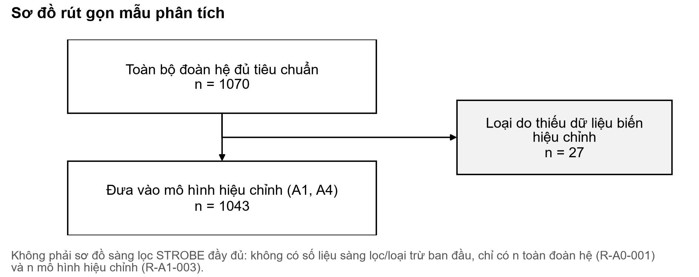
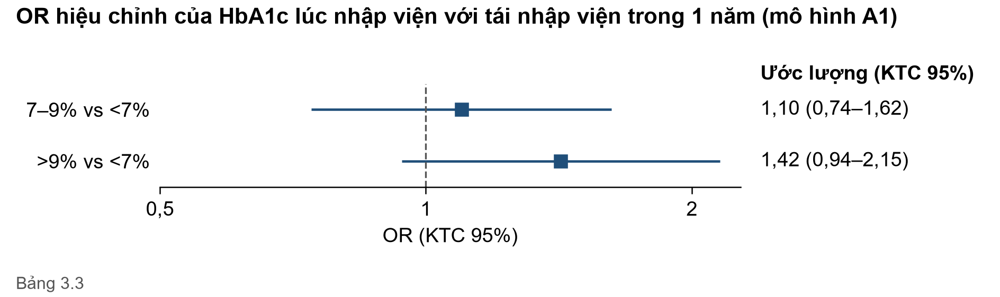

orchestra-role: results

# KẾT QUẢ

Trong giai đoạn 01/01/2021–31/12/2022, 1070 người bệnh đái tháo đường (ĐTĐ) type 2 thỏa tiêu
chuẩn chọn và loại trừ được đưa vào mẫu phân tích mô tả (Hình 1); 27 <!-- derived: R-A0-001.n - R-A1-003.n --> người bệnh (2,5% <!-- derived: (R-A0-001.n - R-A1-003.n) / R-A0-001.n * 100 -->) thiếu
thời gian mắc ĐTĐ, loại khỏi các mô hình hiệu chỉnh theo quy tắc phân tích ca đầy đủ, còn lại
1043 người bệnh.

Hình 1 không phải sơ đồ sàng lọc STROBE đầy đủ: dữ liệu của nghiên cứu không ghi nhận số liệu
sàng lọc/đủ tiêu chuẩn ban đầu, nên sơ đồ chỉ dựng được từ số đưa vào mẫu mô tả (1070) và số
đưa vào các mô hình hiệu chỉnh (1043).

Đặc điểm chung của đối tượng nghiên cứu theo nhóm HbA1c lúc nhập viện được trình bày ở Bảng 1.

Bảng 1. Đặc điểm chung của đối tượng nghiên cứu theo nhóm HbA1c lúc nhập viện (n = 1070)
| Đặc điểm | Chung | <7% | 7–9% | >9% |
|---|---|---|---|---|
| Tuổi (năm), TB ± ĐLC | 63,1 ± 10,5 | 63,7 ± 10,8 | 63,2 ± 10,4 | 62,4 ± 10,3 |
| Nữ, n (%) | 536 (50,1%) | 110 (46,8%) | 254 (49,4%) | 172 (53,6%) |
| Thời gian mắc ĐTĐ (năm), TB ± ĐLC | 9,2 ± 5,2 | 9,0 ± 5,3 | 9,2 ± 5,2 | 9,1 ± 5,3 |
| ≥1 bệnh đồng mắc (THA/BTM/bệnh tim mạch), n (%) | 575 (53,7%) | 136 (57,9%) | 274 (53,3%) | 165 (51,4%) |
| Dùng insulin khi nằm viện, n (%) | 322 (30,1%) | 33 (14,0%) | 129 (25,1%) | 160 (49,8%) |
| Thời gian nằm viện (ngày), trung vị (KTPV) | 7,0 (5,0–10,0) | 7,0 (5,0–9,5) | 7,0 (5,0–10,0) | 7,0 (5,0–9,0) |

Ghi chú: ĐLC: độ lệch chuẩn; KTPV: khoảng tứ phân vị; không kèm giá trị p so sánh 3 nhóm (thiết kế
quan sát, không phải thử nghiệm ngẫu nhiên).

Tuổi và giới tương đồng giữa 3 nhóm HbA1c; nhóm HbA1c >9% có tỷ lệ dùng insulin khi nằm viện cao hơn rõ
so với nhóm <7% (49,8% so với 14,0%), phù hợp với thực hành khởi trị insulin
sau khi biết HbA1c cao — biến này được xem là trung gian nghi ngờ, không hiệu chỉnh trong mô hình chính.

Tỷ lệ tái nhập viện 1 năm và kết quả phân tích chính (Mục tiêu 2) được trình bày ở Bảng 2 và Hình 2.

Bảng 2. Tỷ lệ tái nhập viện mọi nguyên nhân trong 1 năm và tỷ số chênh (OR) thô, hiệu chỉnh theo nhóm HbA1c lúc nhập viện
| Nhóm HbA1c | N | Tái nhập viện, n (%) [KTC 95%] | OR thô (KTC 95%) | OR hiệu chỉnh (KTC 95%) | p (hiệu chỉnh) |
|---|---|---|---|---|---|
| Chung | 1070 | 236 (22,1%) [19,7–24,6] | — | — | — |
| <7% (tham chiếu) | 235 | 46 (19,6%) [15,0–25,1] | 1 | 1 | — |
| 7–9% | 514 | 108 (21,0%) [17,7–24,7] | 1,09 (0,74–1,61) | 1,10 (0,74–1,62) | 0,641 |
| >9% | 321 | 82 (25,5%) [21,1–30,6] | 1,41 (0,94–2,12) | 1,42 (0,94–2,15) | 0,097 |

Ghi chú: KTC: khoảng tin cậy (tỷ lệ: Wilson); OR hiệu chỉnh theo tuổi, giới, thời gian mắc ĐTĐ, ≥1
bệnh đồng mắc; mô hình có diện tích dưới đường cong ROC 0,588, số sự kiện trên mỗi biến
(EPV) 39 <!-- derived: R-A1-010.value, làm tròn đến số nguyên -->.

Tỷ lệ tái nhập viện mọi nguyên nhân trong 1 năm chung là 22,1% (KTC 95%
19,7–24,6); theo từng nhóm, tỷ lệ là 19,6% ở nhóm <7%, 21,0% ở nhóm
7–9% và 25,5% ở nhóm >9%, với khoảng tin cậy của 3 nhóm còn chồng lấp rộng (đề cương
không đăng ký kiểm định xu hướng). Sau hiệu chỉnh, OR đạt 1,10 (KTC 95%:
0,74–1,62) ở nhóm 7–9% và 1,42 (KTC 95%: 0,94–2,15) ở nhóm >9%, so với nhóm
<7%; cả hai cùng chiều với giả thuyết nghiên cứu nhưng khoảng tin cậy 95% đều chứa giá trị 1 — mối
liên quan giữa HbA1c lúc nhập viện và tái nhập viện mọi nguyên nhân trong 1 năm chưa đạt ý nghĩa
thống kê ở cỡ mẫu hiện có.

Kết quả các phân tích phụ được trình bày ở Bảng 3.

Bảng 3. Kết quả các phân tích phụ: HbA1c liên tục, tái nhập viện liên quan đái tháo đường, thời gian đến lần tái nhập viện đầu tiên
| Phân tích phụ | HbA1c 7–9% vs <7% | HbA1c >9% vs <7% (hoặc mỗi 1% HbA1c)* | p (cột bên phải) |
|---|---|---|---|
| HbA1c liên tục, OR hiệu chỉnh mỗi 1% HbA1c | — | 1,02 (0,93–1,11) | 0,677 |
| Tái nhập viện liên quan ĐTĐ, OR hiệu chỉnh | 2,97 (1,31–6,73) | 5,50 (2,42–12,49) | < 0,001 |
| Thời gian đến tái nhập viện đầu tiên, HR hiệu chỉnh | 1,07 (0,75–1,51) | 1,35 (0,94–1,93) | 0,109 |

Ghi chú: *dòng HbA1c liên tục là ước lượng cho mỗi 1% HbA1c tăng thêm, không chia nhóm, trình bày ở
cột bên phải. OR/HR hiệu chỉnh theo cùng biến nhiễu như Bảng 2. Toàn bộ phân tích ở bảng này mang tính
khám phá, không hiệu chỉnh đa so sánh.

Khi dùng HbA1c liên tục, OR hiệu chỉnh mỗi 1% là 1,02 (KTC 95%: 0,93–1,11) — khoảng
tin cậy hẹp quanh giá trị 1. Khi giới hạn kết cục vào tái nhập viện liên quan ĐTĐ, OR hiệu chỉnh cao
hơn rõ và có ý nghĩa thống kê ở cả nhóm 7–9% (2,97; KTC 95%: 1,31–6,73) và nhóm
>9% (5,50; KTC 95%: 2,42–12,49; p < 0,001). Hồi quy Cox cho kết quả cùng
chiều và cùng độ lớn với kết cục chính: HR hiệu chỉnh 1,07 ở nhóm 7–9% và
1,35 ở nhóm >9%, cả hai KTC 95% cũng chứa giá trị 1.

Tử vong trong viện trong 1 năm (không xác định được tử vong ngoài viện) thấp ở cả 3 nhóm, từ
1,3% ở nhóm <7% đến 2,8% ở nhóm >9% (chung: 2,2%); kết cục
này chỉ được mô tả, không phân tích đa biến. Phân tích hậu kiểm (không đăng ký trước) theo nhóm tuổi
cho thấy, ở người <65 tuổi, tỷ số chênh hiệu chỉnh của HbA1c >9% (so với <7%) đạt 1,61 (KTC 95%: 0,86–3,02);
ở người ≥65 tuổi, giá trị này là 1,27 (KTC 95%: 0,72–2,24), với p kiểm định tương tác HbA1c × tuổi là
0,835 —
chưa có bằng chứng hiệu ứng khác nhau thật sự theo tuổi ở cỡ mẫu hiện có; kết quả này chỉ mang tính
khám phá.
