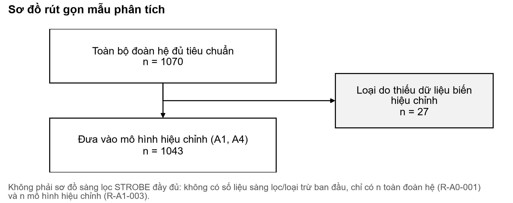
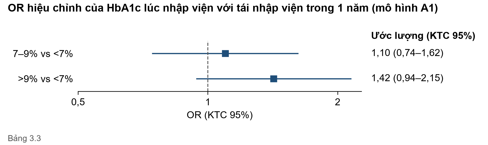

# HbA1c lúc nhập viện và nguy cơ tái nhập viện trong 1 năm ở người bệnh đái tháo đường type 2 xuất viện tại Bệnh viện Mô phỏng (2021–2023): một nghiên cứu đoàn hệ hồi cứu

Tên bài báo rút gọn (running title): HbA1c lúc nhập viện và tái nhập viện 1 năm ở đái tháo đường type 2

**Từ khóa:** HbA1c; tái nhập viện; đái tháo đường type 2; đoàn hệ hồi cứu; Việt Nam

Tác giả: Example author

Đơn vị công tác: Bệnh viện Mô phỏng (cơ sở hư cấu)

Tác giả liên hệ: Example author, Bệnh viện Mô phỏng; địa chỉ liên hệ không công bố vì đây là dự án minh hoạ.

Số từ tóm tắt: 247 <!-- not-a-result: lint_prose.py --count-words, không phải kết quả nghiên cứu --> (giới hạn tạp chí cho tóm tắt: 250 <!-- not-a-result: target.word_limit, project.yaml -->)

Số từ chính văn: 3480 <!-- not-a-result: lint_prose.py --count-words trên bản đã thay số (.rendered.md), không phải kết quả nghiên cứu --> (giới hạn tạp chí cho chính văn: 3500 <!-- not-a-result: target.text_words, project.yaml -->)

Số bảng: 3 — Số hình: 2

> Dự án mô phỏng. Bệnh viện Mô phỏng là địa điểm hư cấu; toàn bộ số liệu là dữ liệu mô phỏng, dùng để minh họa quy trình soạn bài báo từ kết quả đã khóa (gate G3); không có bệnh nhân thật, không có dữ liệu định danh, không có giá trị khoa học hay lâm sàng ngoài mục đích minh họa.

## Tuyên bố

Tài trợ: Nghiên cứu không nhận tài trợ từ bất kỳ tổ chức nào; đây là dự án minh hoạ với dữ liệu mô
phỏng.

Xung đột lợi ích: Tác giả không có xung đột lợi ích.

Đạo đức nghiên cứu: Không có số quyết định: đây là dự án minh hoạ dùng dữ liệu mô phỏng, chưa nộp
Hội đồng Đạo đức; một nghiên cứu thật phải được Hội đồng Đạo đức của Bệnh viện chấp thuận trước khi
trích xuất dữ liệu.

Chia sẻ dữ liệu: Dữ liệu mô phỏng và mã phân tích nằm trong thư mục dự án (04_data/, 05_analysis/).

Đóng góp của tác giả: Example author thực hiện toàn bộ các bước, có sử dụng công cụ AI như mô tả
trong công bố sử dụng AI (out/ai-use-disclosure.md).

Công bố sử dụng AI: xem out/ai-use-disclosure.md.

\newpage

orchestra-role: abstract

# TÓM TẮT

**Mục tiêu:** Mô tả đặc điểm và tỷ lệ tái nhập viện trong 1 năm, và xác định mối liên quan giữa HbA1c
lúc nhập viện và tái nhập viện trong 1 năm ở người bệnh đái tháo đường (ĐTĐ) type 2.

**Đối tượng và phương pháp:** Nghiên cứu đoàn hệ hồi cứu, đơn trung tâm, tại Khoa Nội tiết, Bệnh viện
Mô phỏng, trên 1070 người bệnh ĐTĐ type 2 xuất viện 01/2021–12/2022, theo dõi tái nhập viện
365 <!-- not-a-result: mốc theo dõi của đề tài, 01_question/question.md --> ngày qua hệ thống thông
tin bệnh viện. Phơi nhiễm là HbA1c đo trong 24–48 giờ đầu nhập viện (3
nhóm <7% / 7–9% / >9%, nhóm <7% tham chiếu). Hồi quy logistic đa biến hiệu chỉnh tuổi, giới, thời gian
mắc ĐTĐ và bệnh đồng mắc ước lượng tỷ số chênh (OR) kèm khoảng tin cậy 95% (KTC).

**Kết quả:** Tỷ lệ tái nhập viện mọi nguyên nhân trong 1 năm chung là 22,1% (KTC 95%
19,7–24,6). Sau hiệu chỉnh, OR của tái nhập viện là 1,10 (KTC 95%:
0,74–1,62) ở nhóm HbA1c 7–9% và 1,42 (KTC 95%: 0,94–2,15) ở nhóm >9%, so với
nhóm <7%; cả hai khoảng tin cậy 95% đều chứa giá trị 1.

**Kết luận:** Chưa tìm thấy mối liên quan có ý nghĩa thống kê giữa HbA1c lúc nhập viện và tái nhập
viện mọi nguyên nhân trong 1 năm ở cỡ mẫu hiện có; cần nghiên cứu cỡ mẫu lớn hơn, đa trung tâm để
kiểm định lại.

**Từ khóa:** HbA1c; tái nhập viện; đái tháo đường type 2; đoàn hệ hồi cứu.

\newpage

orchestra-role: introduction

# ĐẶT VẤN ĐỀ

Ở người bệnh đái tháo đường (ĐTĐ) type 2, tái nhập viện sau xuất viện thường được dùng như một chỉ số
của chất lượng chăm sóc và gánh nặng bệnh tật trên hệ thống y tế <!-- not-a-result: không có tài liệu
dịch tễ học chung nào được xác minh trong ledger của đề tài -->. Kiểm soát đường huyết kém lúc nhập
viện, phản ánh qua chỉ số HbA1c, được xem là một dấu hiệu của bệnh nền chưa ổn định và có thể liên
quan với nguy cơ tái nhập viện cao hơn sau xuất viện.

Bằng chứng hiện có tập trung ở các mốc theo dõi ngắn: một nghiên cứu đoàn hệ hồi cứu tại Trung Quốc
ghi nhận HbA1c lúc nhập viện cao hơn liên quan tăng nguy cơ tái nhập viện trong 30 ngày ở người bệnh
ĐTĐ type 2 trẻ và trung niên [1]; một nomogram khác cũng xác định HbA1c là yếu tố dự báo tái
nhập viện 31 ngày, dù không nêu chiều hướng riêng [2]. Ở mốc 365 <!-- not-a-result: mốc theo dõi của li2026, không phải của đề tài này --> ngày, một mô hình học máy cho thấy yếu tố dự báo
chuyển dần từ cấp tính sang mạn tính theo thời gian, nhưng không tách riêng được hiệu ứng độc lập của
HbA1c [3]; một nghiên cứu tại Anh lại cho thấy HbA1c đo sau xuất viện thấp hơn liên quan tái
nhập viện cao hơn [4], gợi ý mối liên quan có thể phụ thuộc thời điểm đo. Một tổng quan hệ
thống về can thiệp trong bệnh viện trả lời câu hỏi hiệu quả can thiệp, không phải về HbA1c như yếu tố
liên quan tự nhiên [5]; hướng dẫn hiện hành của Hội Đái tháo đường Hoa Kỳ đề cập kiểm
soát đường huyết nội viện nói chung, không đưa ngưỡng HbA1c cụ thể để dự phòng tái nhập viện dài hạn
[6].

Nhìn chung, bằng chứng cho câu hỏi ở mốc 1 năm có độ chắc chắn rất thấp: phần lớn nghiên cứu ở mốc
ngắn hơn, nghiên cứu duy nhất ở mốc 1 năm không tách riêng hiệu ứng HbA1c, và chưa có nghiên cứu nào
đối chiếu trực tiếp HbA1c lúc nhập viện với tái nhập viện ở đúng mốc này. Trong phạm vi tìm kiếm trên
PubMed đã thực hiện, chưa tìm thấy nghiên cứu tại Việt Nam trả lời câu hỏi này <!-- not-a-result: 02_evidence/gaps.md Gap 2; tạp chí tiếng Việt không được lập chỉ mục trên PubMed và chưa được tìm
trong phiên tìm kiếm này -->.

Vì vậy, nghiên cứu này là một đoàn hệ hồi cứu, đơn trung tâm, tại Khoa Nội tiết, Bệnh viện Mô phỏng,
với hai mục tiêu: (1) mô tả đặc điểm lâm sàng, cận lâm sàng — trong đó có HbA1c lúc nhập viện — và tỷ
lệ tái nhập viện trong 1 năm của người bệnh ĐTĐ type 2 xuất viện giai đoạn 2021–2022; và (2) xác định
mối liên quan giữa HbA1c lúc nhập viện và tái nhập viện trong 1 năm, có hiệu chỉnh một số yếu tố nhiễu
(tuổi, giới, thời gian mắc bệnh, bệnh đồng mắc).

orchestra-role: methods

# ĐỐI TƯỢNG VÀ PHƯƠNG PHÁP NGHIÊN CỨU

**Thiết kế, địa điểm và thời gian.** Đây là nghiên cứu đoàn hệ hồi cứu, đơn trung tâm, thực hiện tại
Khoa Nội tiết, Bệnh viện Mô phỏng. Người bệnh được chọn theo thời điểm xuất viện (nhập viện chỉ số) từ
01/01/2021 đến 31/12/2022; kết cục được theo dõi 365 <!-- not-a-result: mốc theo dõi của đề tài, 01_question/question.md --> ngày kể từ ngày xuất viện của mỗi người bệnh, qua hệ thống thông tin bệnh
viện (HIS) đến 31/12/2023. Báo cáo theo STROBE (bản 2007).

**Đối tượng nghiên cứu.** Tiêu chuẩn chọn: chẩn đoán ĐTĐ type 2 (ICD-10 khối E11) ghi trong hồ sơ ra
viện; ≥ 18 tuổi; xuất viện từ Khoa Nội tiết, Bệnh viện Mô phỏng trong giai đoạn trên; có HbA1c đo trong
24–48 giờ đầu nhập viện. Tiêu chuẩn loại, áp dụng tuần tự: (1) tử vong trong lần nhập viện chỉ số —
không có thời gian theo dõi sau xuất viện; (2) ĐTĐ thai kỳ, type 1 hoặc thứ phát — cơ chế bệnh khác ĐTĐ
type 2; (3) không có HbA1c đo trong 24–48 giờ đầu nhập viện — thiếu giá trị phơi nhiễm chính; (4) xuất
viện nhiều lần trong giai đoạn trên — chỉ lần xuất viện đầu tiên được lấy làm nhập viện chỉ số. Dữ liệu
nguồn không ghi số người bệnh bị loại theo từng lý do riêng, chỉ có tổng số đưa vào mẫu phân tích (xem
Hạn chế). Chọn mẫu toàn bộ (census). Cỡ mẫu yêu cầu cho so sánh 2 nhóm
HbA1c cực (giả thuyết OR = 1,5 <!-- not-a-result: sample-size.md §3b, giả định -->) là 1.070 <!-- not-a-result: sample-size.md §3c --> người bệnh, so với 1.200 <!-- not-a-result: sample-size.md §2, số ước tính --> người bệnh khả dụng — rủi ro thiếu lực mẫu được chấp nhận trước khi xem dữ liệu (xem
Hạn chế). Số người bệnh thực tế đưa vào mẫu phân tích là 1070.

**Biến số.** Phơi nhiễm chính là HbA1c đo trong 24–48 giờ đầu nhập viện, phân tích chính theo 3 nhóm
< 7% / 7–9% / > 9% (nhóm < 7% tham chiếu); phân tích phụ dùng HbA1c liên tục (mỗi 1%). Kết cục chính là
tái nhập viện do mọi nguyên nhân trong vòng 365 <!-- not-a-result: mốc theo dõi của đề tài --> ngày
kể từ ngày xuất viện. Kết cục phụ gồm: tái nhập viện liên quan ĐTĐ/biến chứng đường huyết; thời gian
đến lần tái nhập viện đầu tiên (kiểm duyệt tại 365 <!-- not-a-result: mốc theo dõi của đề tài --> ngày);
và tử vong trong 1 năm — chỉ ghi nhận được tử vong **trong viện** nên chỉ báo cáo mô tả. Biến nhiễu
đưa vào mô hình hiệu chỉnh chính (định trước): tuổi, giới, thời gian mắc ĐTĐ, có/không ≥ 1 bệnh đồng
mắc chính. Insulin khi nằm viện và thời gian nằm viện được đo sau hoặc đồng thời với HbA1c nên có thể
là biến trung gian; hai biến này chỉ dùng mô tả.

**Nguồn dữ liệu.** Dữ liệu được trích xuất từ hồ sơ bệnh án điện tử và HIS của Bệnh viện Mô phỏng,
2021–2023.

**Sai số.** HIS chỉ ghi tái nhập viện tại chính Bệnh viện Mô phỏng — người tái nhập viện ở cơ sở khác
bị tính nhầm là không tái nhập viện (hướng, độ lớn chưa rõ). Nhiễu do chỉ định được kiểm soát bằng
hiệu chỉnh đa biến; sai lệch thời gian bất tử được hạn chế vì phơi nhiễm được đo và cố định trước thời
điểm bắt đầu theo dõi.

**Xử lý và phân tích số liệu.** Dữ liệu được quản lý và phân tích bằng Python (pandas, statsmodels)
<!-- not-a-result: 05_analysis/output/results.json → engine -->. Mục tiêu 1 dùng thống kê mô tả (trung
bình ± độ lệch chuẩn hoặc trung vị [khoảng liên phân vị]; tần số, tỷ lệ %; tỷ lệ tái nhập viện kèm KTC
95% Wilson). Mục tiêu 2 dùng hồi quy logistic đa biến, hiệu chỉnh các biến nhiễu nêu trên, báo cáo OR
thô và hiệu chỉnh kèm KTC 95%. Phân tích phụ khám phá, không hiệu chỉnh đa so sánh, gồm: HbA1c liên
tục; tái nhập viện liên quan ĐTĐ; thời gian đến lần tái nhập viện đầu tiên bằng hồi quy Cox (giả định
nguy cơ tỷ lệ kiểm tra bằng phần dư Schoenfeld); tử vong trong viện (chỉ mô tả) — không làm độ nhạy
Fine-Gray vì tử vong trong viện chỉ xảy ra sau tái nhập viện, không phải nguy cơ cạnh tranh thật. Mức ý
nghĩa α = 0,05 hai phía chỉ áp dụng cho kết cục chính. Biến thời gian mắc ĐTĐ thiếu ở 27 <!-- derived: R-A0-001.n - R-A1-003.n --> người bệnh (2,5% <!-- derived: (R-A0-001.n - R-A1-003.n) / R-A0-001.n * 100 -->), biến duy nhất thiếu dữ liệu; vì ≤ 5% trên một biến nhiễu, dùng phân tích ca đầy đủ. Thời gian
theo dõi cố định 365 <!-- not-a-result: mốc theo dõi của đề tài --> ngày cho mọi người bệnh theo thiết
kế. Sau khi xem kết quả đã khóa, một phân tích hậu kiểm không đăng ký trước được thực hiện theo đề
nghị của tác giả: hiệu ứng nhóm HbA1c lên tái nhập viện theo nhóm tuổi (< 65 so với ≥ 65), dùng cùng
biến hiệu chỉnh cộng kiểm định tương tác; kết quả mang tính khám phá.

**Đạo đức nghiên cứu.** Nghiên cứu hồi cứu trên dữ liệu đã có sẵn, không can thiệp; dữ liệu được mã
hóa bằng số thứ tự nghiên cứu, loại bỏ định danh cá nhân trước khi phân tích. Không có số quyết định:
dự án minh hoạ dùng dữ liệu mô phỏng, chưa nộp Hội đồng Đạo đức; một nghiên cứu thật phải được Hội
đồng Đạo đức của Bệnh viện chấp thuận trước khi trích xuất dữ liệu.

orchestra-role: results

# KẾT QUẢ

Trong giai đoạn 01/01/2021–31/12/2022, 1070 người bệnh đái tháo đường (ĐTĐ) type 2 thỏa tiêu
chuẩn chọn và loại trừ được đưa vào mẫu phân tích mô tả (Hình 1); 27 <!-- derived: R-A0-001.n - R-A1-003.n --> người bệnh (2,5% <!-- derived: (R-A0-001.n - R-A1-003.n) / R-A0-001.n * 100 -->) thiếu
thời gian mắc ĐTĐ, loại khỏi các mô hình hiệu chỉnh theo quy tắc phân tích ca đầy đủ, còn lại
1043 người bệnh.

Hình 1 không phải sơ đồ sàng lọc STROBE đầy đủ: dữ liệu của nghiên cứu không ghi nhận số liệu
sàng lọc/đủ tiêu chuẩn ban đầu, nên sơ đồ chỉ dựng được từ số đưa vào mẫu mô tả (1070) và số
đưa vào các mô hình hiệu chỉnh (1043).

Đặc điểm chung của đối tượng nghiên cứu theo nhóm HbA1c lúc nhập viện được trình bày ở Bảng 1.

Bảng 1. Đặc điểm chung của đối tượng nghiên cứu theo nhóm HbA1c lúc nhập viện (n = 1070)
| Đặc điểm | Chung | <7% | 7–9% | >9% |
|---|---|---|---|---|
| Tuổi (năm), TB ± ĐLC | 63,1 ± 10,5 | 63,7 ± 10,8 | 63,2 ± 10,4 | 62,4 ± 10,3 |
| Nữ, n (%) | 536 (50,1%) | 110 (46,8%) | 254 (49,4%) | 172 (53,6%) |
| Thời gian mắc ĐTĐ (năm), TB ± ĐLC | 9,2 ± 5,2 | 9,0 ± 5,3 | 9,2 ± 5,2 | 9,1 ± 5,3 |
| ≥1 bệnh đồng mắc (THA/BTM/bệnh tim mạch), n (%) | 575 (53,7%) | 136 (57,9%) | 274 (53,3%) | 165 (51,4%) |
| Dùng insulin khi nằm viện, n (%) | 322 (30,1%) | 33 (14,0%) | 129 (25,1%) | 160 (49,8%) |
| Thời gian nằm viện (ngày), trung vị (KTPV) | 7,0 (5,0–10,0) | 7,0 (5,0–9,5) | 7,0 (5,0–10,0) | 7,0 (5,0–9,0) |

Ghi chú: ĐLC: độ lệch chuẩn; KTPV: khoảng tứ phân vị; không kèm giá trị p so sánh 3 nhóm (thiết kế
quan sát, không phải thử nghiệm ngẫu nhiên).

Tuổi và giới tương đồng giữa 3 nhóm HbA1c; nhóm HbA1c >9% có tỷ lệ dùng insulin khi nằm viện cao hơn rõ
so với nhóm <7% (49,8% so với 14,0%), phù hợp với thực hành khởi trị insulin
sau khi biết HbA1c cao — biến này được xem là trung gian nghi ngờ, không hiệu chỉnh trong mô hình chính.

Tỷ lệ tái nhập viện 1 năm và kết quả phân tích chính (Mục tiêu 2) được trình bày ở Bảng 2 và Hình 2.

Bảng 2. Tỷ lệ tái nhập viện mọi nguyên nhân trong 1 năm và tỷ số chênh (OR) thô, hiệu chỉnh theo nhóm HbA1c lúc nhập viện
| Nhóm HbA1c | N | Tái nhập viện, n (%) [KTC 95%] | OR thô (KTC 95%) | OR hiệu chỉnh (KTC 95%) | p (hiệu chỉnh) |
|---|---|---|---|---|---|
| Chung | 1070 | 236 (22,1%) [19,7–24,6] | — | — | — |
| <7% (tham chiếu) | 235 | 46 (19,6%) [15,0–25,1] | 1 | 1 | — |
| 7–9% | 514 | 108 (21,0%) [17,7–24,7] | 1,09 (0,74–1,61) | 1,10 (0,74–1,62) | 0,641 |
| >9% | 321 | 82 (25,5%) [21,1–30,6] | 1,41 (0,94–2,12) | 1,42 (0,94–2,15) | 0,097 |

Ghi chú: KTC: khoảng tin cậy (tỷ lệ: Wilson); OR hiệu chỉnh theo tuổi, giới, thời gian mắc ĐTĐ, ≥1
bệnh đồng mắc; mô hình có diện tích dưới đường cong ROC 0,588, số sự kiện trên mỗi biến
(EPV) 39 <!-- derived: R-A1-010.value, làm tròn đến số nguyên -->.

Tỷ lệ tái nhập viện mọi nguyên nhân trong 1 năm chung là 22,1% (KTC 95%
19,7–24,6), khác nhau giữa 3 nhóm HbA1c (Bảng 2), với khoảng tin cậy 3 nhóm còn chồng lấp rộng.
Sau hiệu chỉnh, OR đạt 1,10 (KTC 95%:
0,74–1,62) ở nhóm 7–9% và 1,42 (KTC 95%: 0,94–2,15) ở nhóm >9% so với nhóm
<7%; cùng chiều với giả thuyết nghiên cứu nhưng cả hai khoảng tin cậy 95% đều chứa giá trị 1 — mối
liên quan chưa đạt ý nghĩa thống kê ở cỡ mẫu hiện có.

Kết quả các phân tích phụ được trình bày ở Bảng 3.

Bảng 3. Kết quả các phân tích phụ: HbA1c liên tục, tái nhập viện liên quan đái tháo đường, thời gian đến lần tái nhập viện đầu tiên
| Phân tích phụ | HbA1c 7–9% vs <7% | HbA1c >9% vs <7% (hoặc mỗi 1% HbA1c)* | p (cột bên phải) |
|---|---|---|---|
| HbA1c liên tục, OR hiệu chỉnh mỗi 1% HbA1c | — | 1,02 (0,93–1,11) | 0,677 |
| Tái nhập viện liên quan ĐTĐ, OR hiệu chỉnh | 2,97 (1,31–6,73) | 5,50 (2,42–12,49) | < 0,001 |
| Thời gian đến tái nhập viện đầu tiên, HR hiệu chỉnh | 1,07 (0,75–1,51) | 1,35 (0,94–1,93) | 0,109 |

Ghi chú: *dòng HbA1c liên tục là ước lượng cho mỗi 1% HbA1c tăng thêm, không chia nhóm, trình bày ở
cột bên phải. OR/HR hiệu chỉnh theo cùng biến nhiễu như Bảng 2. Toàn bộ phân tích ở bảng này mang tính
khám phá, không hiệu chỉnh đa so sánh.

HbA1c liên tục cho OR hiệu chỉnh 1,02 (KTC 95%: 0,93–1,11) mỗi 1% — khoảng hẹp
quanh giá trị 1. Khi giới hạn kết cục vào tái nhập viện liên quan ĐTĐ, OR hiệu chỉnh cao hơn rõ và có
ý nghĩa ở cả nhóm 7–9% (2,97; 1,31–6,73) và nhóm >9% (5,50;
2,42–12,49; p < 0,001). Hồi quy Cox cho HR hiệu chỉnh cùng chiều, cùng độ lớn:
1,07 ở nhóm 7–9%, 1,35 ở nhóm >9%, cả hai KTC cũng chứa 1.

Tử vong trong viện trong 1 năm (không xác định được tử vong ngoài viện) thấp ở cả 3 nhóm, từ
1,3% đến 2,8% (chung: 2,2%); chỉ mô tả, không phân tích đa
biến. Phân tích hậu kiểm (không đăng ký trước) theo tuổi: ở người <65 tuổi, OR hiệu chỉnh của HbA1c
>9% (so <7%) là 1,61 (KTC 95%: 0,86–3,02); ở người ≥65 tuổi là 1,27 (KTC 95%: 0,72–2,24), p tương tác HbA1c × tuổi =
0,835 — chưa có bằng chứng hiệu ứng khác theo tuổi; kết quả chỉ mang tính khám phá.

orchestra-role: discussion

# BÀN LUẬN

Trong mẫu 1070 người bệnh đái tháo đường (ĐTĐ) type 2, sau hiệu chỉnh tuổi, giới, thời gian
mắc ĐTĐ và bệnh đồng mắc, so với nhóm HbA1c <7%, tỷ số chênh (OR) của tái nhập viện mọi nguyên nhân
trong 1 năm đạt 1,10 (KTC 95%: 0,74–1,62) ở nhóm 7–9% và 1,42 (KTC 95%: 0,94–2,15) ở nhóm >9%. Cả hai ước lượng
cùng chiều với giả thuyết nghiên cứu (HbA1c cao hơn đi kèm OR > 1), nhưng khoảng tin cậy 95% (KTC) của
cả hai đều chứa giá trị 1 — mối liên quan giữa HbA1c lúc nhập viện và tái nhập viện trong 1 năm
**chưa được chứng minh có ý nghĩa thống kê** ở cỡ mẫu hiện có; đây là một ước lượng chưa chính xác
(imprecise), không phải bằng chứng cho việc không có liên quan.

So với y văn, kết quả này cùng hướng nhưng kém chắc chắn hơn một nghiên cứu đoàn hệ tại Trung Quốc ở
người ĐTĐ type 2 trẻ và trung niên (18–59 <!-- not-a-result: hu2026, tiêu chuẩn tuổi của nghiên cứu đó --> tuổi), ghi nhận HbA1c lúc nhập viện liên quan có ý nghĩa thống kê với tái nhập viện trong 30
ngày (mỗi 1% HbA1c, aOR = 1,15 <!-- not-a-result: hu2026, tái nhập viện 30 ngày -->) [1] — khác
biệt có thể do mốc theo dõi của [1] ngắn hơn nhiều (30 so với 365 <!-- not-a-result: mốc theo dõi của đề tài --> ngày) và quần thể hẹp hơn. Một nghiên cứu tại Anh ghi nhận chiều hướng ngược lại khi
HbA1c đo sau xuất viện, không phải lúc nhập viện [4], gợi ý mối liên quan có thể phụ thuộc
thời điểm đo. Nghiên cứu duy nhất ở mốc 1 năm dùng mô hình học máy không tách riêng được hiệu ứng độc
lập của HbA1c [3], nên không đối chiếu trực tiếp được.

Về cơ chế, HbA1c phản ánh kiểm soát đường huyết trung bình khoảng 3 tháng trước; kiểm soát kém kéo dài
**có thể** đi kèm nhiễm trùng, biến chứng mạch máu và suy giảm miễn dịch — các yếu tố **có thể liên
quan** nguy cơ tái nhập viện, một giả thuyết sinh lý bệnh hợp lý nhưng chưa được khảo sát trực tiếp ở
quần thể và mốc thời gian của nghiên cứu này.

Các phân tích phụ nhất quán với kết quả chính: HbA1c liên tục (mỗi 1%) cho OR hiệu chỉnh
1,02 (KTC 95%: 0,93–1,11), KTC hẹp quanh giá trị 1; hồi quy Cox cho HR hiệu chỉnh cùng chiều và cùng độ lớn
(1,07 (KTC 95%: 0,75–1,51) ở nhóm 7–9%, 1,35 (KTC 95%: 0,94–1,93) ở nhóm >9%, cả hai KTC cũng chứa 1) — không thêm
bằng chứng mới. Ngược lại, khi giới hạn kết cục vào tái nhập viện liên quan ĐTĐ, OR hiệu chỉnh cao hơn
rõ và có ý nghĩa ở cả hai nhóm (2,97 (KTC 95%: 1,31–6,73) và 5,50 (KTC 95%: 2,42–12,49)) — một phát hiện đáng chú ý
nhưng là kết cục phụ khám phá, cần kiểm định lại ở nghiên cứu độc lập. Phân tích hậu kiểm theo tuổi
(không đăng ký trước) không cho thấy hiệu ứng HbA1c khác nhau có ý nghĩa giữa người <65 và ≥65 tuổi (p
tương tác = 0,835), nhưng KTC mỗi tầng rất rộng do cỡ mẫu giảm một nửa — chưa có bằng
chứng khác biệt, không phải bằng chứng hiệu ứng giống nhau.

**Điểm mạnh.** Nghiên cứu lấy mẫu toàn bộ (census), tránh sai lệch chọn mẫu thuận tiện; thời điểm đo
phơi nhiễm (24–48 giờ đầu nhập viện) được cố định trước khi theo dõi kết cục nên nguy cơ sai lệch thời
gian bất tử thấp. Biến nhiễu được chọn trước khi thu thập dữ liệu, dựa trên y văn và kiến thức lâm
sàng, không theo kết quả kiểm định đơn biến; bảng đăng ký phân tích công khai trước khi xem dữ liệu
phân biệt rõ phân tích định trước với hậu kiểm.

**Hạn chế.** Thứ nhất, lực mẫu: OR chính và HR phụ đều không đạt ý nghĩa thống kê với KTC rộng chứa 1,
phù hợp với rủi ro lực mẫu đã chấp nhận trước khi có dữ liệu — một hiệu ứng thật khiêm tốn có thể
không được phát hiện ở α = 0,05. Thứ hai, sai lệch thông tin: HIS chỉ ghi tái nhập viện tại chính cơ
sở này, nên người tái nhập viện ở nơi khác bị tính nhầm là không tái nhập viện (hướng và độ lớn chưa
xác định được). Thứ ba, sai lệch chọn
mẫu: tiêu chuẩn loại người thiếu HbA1c hợp lệ có thể làm mẫu nghiêng về người bệnh ổn định hơn lúc
nhập viện; số người bị loại theo từng tiêu chuẩn riêng không có trong dữ liệu nguồn nên không ước
lượng được quy mô sai lệch này. Thứ tư, nhiễu tồn dư: mô hình chính chỉ hiệu chỉnh 4 yếu tố định trước.
Một số yếu tố khác có thể ảnh hưởng đồng thời đến HbA1c lúc nhập viện và nguy cơ tái nhập viện nhưng
không có trong dữ liệu hồi cứu này: mức độ tuân thủ điều trị và tái khám trước đó (hướng nhiễu khó
đoán); tình trạng kinh tế–xã hội và khả năng tiếp cận chăm sóc sau xuất viện (người khó khăn hơn có
thể vừa kiểm soát đường huyết kém hơn vừa ít được theo dõi sau ra viện, nên có thể đẩy OR quan sát
được lên cao hơn giá trị thật); và mức độ nặng của bệnh đồng mắc (chỉ ghi có/không, không có thang
điểm, nên phần nhiễu do bệnh đồng mắc có thể chưa được hiệu chỉnh hết). Không đo được các yếu tố này
nên không thể định lượng hướng hay độ lớn phần nhiễu còn lại; KTC rộng quan sát được có thể phản ánh
một phần nhiễu tồn dư, không chỉ cỡ mẫu nhỏ. Thứ năm, dữ liệu thiếu: 27 <!-- derived: R-A0-001.n - R-A1-003.n --> người bệnh (2,5% <!-- derived: (R-A0-001.n - R-A1-003.n) / R-A0-001.n * 100 -->)
thiếu thời gian mắc ĐTĐ, bị loại theo quy tắc ca đầy đủ; tỷ lệ thấp nên ít khả năng sai lệch lớn. Thứ
sáu, tử vong chỉ ghi nhận được trong viện: phân tích Cox chính coi tử vong ngoài viện như kiểm duyệt —
giả định có thể không đúng nếu tử vong ngoài viện liên quan HbA1c. Các kết quả phụ và hậu kiểm theo
tuổi mang tính khám phá, không hiệu chỉnh đa so sánh; kết quả chỉ áp dụng cho người bệnh ĐTĐ type 2
tại một khoa của một bệnh viện tuyến tỉnh giai đoạn 2021–2022, không ngoại suy sang nơi khác khi chưa
có dữ liệu riêng kiểm chứng.

**Ý nghĩa thực hành và nghiên cứu.** Trong phạm vi quần thể và cỡ mẫu đã khảo sát, chưa đủ bằng chứng
để khẳng định hoặc dùng HbA1c lúc nhập viện làm yếu tố phân loại nguy cơ tái nhập viện trong thực
hành. Phát hiện về tái nhập viện liên quan ĐTĐ và kết quả hậu kiểm theo tuổi gợi ý hướng cho nghiên
cứu xác nhận tiếp theo, đa trung tâm, cỡ mẫu lớn hơn.

orchestra-role: conclusion

# KẾT LUẬN

Ở người bệnh đái tháo đường type 2 xuất viện tại Khoa Nội tiết, Bệnh viện Mô phỏng giai đoạn 2021–2022:
(1) tỷ lệ tái nhập viện mọi nguyên nhân trong 1 năm là 22,1% (KTC 95%: 19,7–24,6), từ
19,6% ở nhóm HbA1c <7% đến 25,5% ở nhóm >9%; (2) sau hiệu chỉnh tuổi, giới,
thời gian mắc đái tháo đường và bệnh đồng mắc, chưa tìm thấy mối liên quan có ý nghĩa thống kê giữa
HbA1c lúc nhập viện và tái nhập viện trong 1 năm (OR hiệu chỉnh ở nhóm 7–9% là 1,10 (KTC 95%: 0,74–1,62) và ở
nhóm >9% là 1,42 (KTC 95%: 0,94–2,15), cả hai khoảng tin cậy 95% đều chứa giá trị 1). Ước lượng này còn thiếu
chính xác, chưa đủ để khẳng định hoặc loại trừ một mối liên quan thật; cần nghiên cứu đa trung tâm, cỡ
mẫu lớn hơn để kiểm định lại.
<!-- results: R-A0-001, R-A0-061, R-A0-062, R-A0-064, R-A1-003, R-A1-004 -->

\newpage

# TÀI LIỆU THAM KHẢO

1. Hu X, Su X, Chen S, Wang Q, He F, Zhang R. Predictors of 30-day readmission in young and middle-aged T2DM patients: a retrospective cohort study. Endocrine. 2026;91(1). doi:10.1007/s12020-026-04626-3. PMID: 42068438.
2. Cao J, Shi Q, Yu Z, Xie H. A nomogram incorporating nutritional risk for predicting 31-day unplanned readmission in adults with type 2 diabetes mellitus using LASSO regression. Front Nutr. 2026;13:1863130. doi:10.3389/fnut.2026.1863130. PMID: 42876841.
3. Li L, Jiang S. Dynamic evolution of readmission risk factors across short-, medium-, and long-term horizons in type 2 diabetes: a machine learning-based predictive modeling study with SHAP interpretability. Front Endocrinol (Lausanne). 2026;17:1827506. doi:10.3389/fendo.2026.1827506. PMID: 42440445.
4. Robbins T, Sankaranarayanan S, Randeva H, Keung SNLC, Arvanitis TN. Association between glycosylated haemoglobin and outcomes for patients discharged from hospital with diabetes: A health informatics approach. Digit Health. 2021;7:20552076211007661. doi:10.1177/20552076211007661. PMID: 33948220.
5. Chakraborty A, Pearson O, Schwartzkopff KM, O'rourke I, Ranasinghe I, Mah PM, et al. The effectiveness of in-hospital interventions on reducing hospital length of stay and readmission of patients with Type 2 Diabetes Mellitus: A systematic review. Diabetes Res Clin Pract. 2021;174:108363. doi:10.1016/j.diabres.2020.108363. PMID: 32771487.
6. American Diabetes Association Professional Practice Committee for Diabetes. 16. Diabetes Care in the Hospital: Standards of Care in Diabetes-2026. Diabetes Care. 2026;49(Supplement_1):S339-S355. doi:10.2337/dc26-S016. PMID: 41358892.
