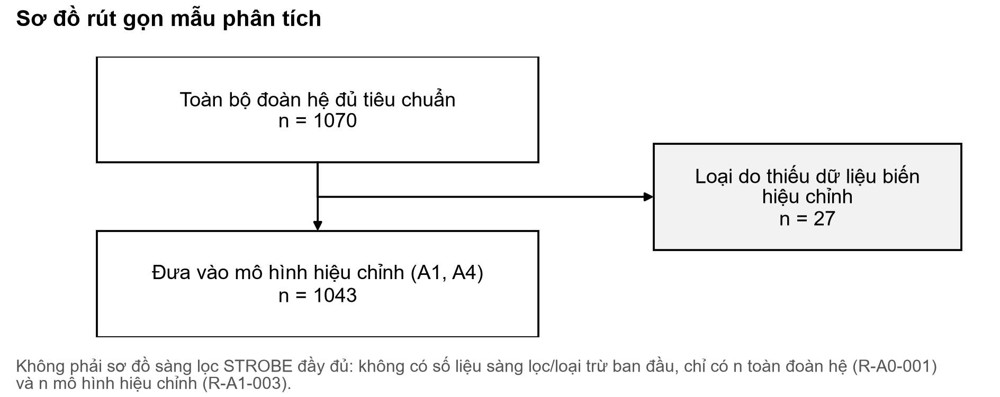

**MỤC LỤC**

{TOC}

\newpage

orchestra-role: abstract

# TÓM TẮT

<!-- Dữ liệu mô phỏng: toàn bộ số liệu trong tóm tắt này là dữ liệu MÔ PHỎNG của dự án ví dụ, không phải số liệu bệnh nhân thật, không có giá trị lâm sàng. -->

## Mục tiêu

Xác định mối liên quan giữa HbA1c lúc nhập viện và tái nhập viện do mọi nguyên nhân trong 1 năm sau
xuất viện ở người bệnh đái tháo đường (ĐTĐ) type 2.

## Đối tượng và phương pháp

Nghiên cứu đoàn hệ hồi cứu, đơn trung tâm, trên 1070 người bệnh ĐTĐ type 2 xuất viện tại
Khoa Nội tiết, Bệnh viện Mô phỏng giai đoạn 2021–2022, theo dõi tái nhập viện trong 1 năm qua hệ
thống thông tin bệnh viện. Phơi nhiễm là HbA1c đo trong 24–48 giờ đầu nhập viện, phân tích chính theo
3 nhóm < 7% / 7–9% / > 9% (nhóm < 7% tham chiếu). Phân tích chính là hồi quy logistic đa biến cho kết
cục tái nhập viện mọi nguyên nhân trong 1 năm, hiệu chỉnh tuổi, giới, thời gian mắc ĐTĐ và bệnh đồng
mắc.

## Kết quả

Tỷ lệ tái nhập viện mọi nguyên nhân trong 1 năm chung của mẫu là 22,1% (KTC 95%: 19,7–24,6). Mô hình hồi quy
logistic hiệu chỉnh cho kết quả tỷ số chênh (OR) là 1,10 (KTC 95%: 0,74–1,62) ở nhóm 7–9% và
1,42 (KTC 95%: 0,94–2,15) ở nhóm > 9%, cả hai so với nhóm tham chiếu < 7%; khoảng tin cậy 95% của cả hai đều
bao gồm giá trị 1.

## Kết luận

Trong mẫu nghiên cứu này, chưa tìm thấy mối liên quan có ý nghĩa thống kê giữa HbA1c lúc nhập viện và
tái nhập viện mọi nguyên nhân trong 1 năm sau xuất viện; ước lượng hiệu chỉnh còn chưa đạt độ chính
xác cần thiết để kết luận.

\newpage

orchestra-role: introduction

# ĐẶT VẤN ĐỀ

Ở người bệnh đái tháo đường (ĐTĐ) type 2, tái nhập viện sau xuất viện là một chỉ số thường được dùng
để đánh giá chất lượng chăm sóc và gánh nặng bệnh tật trên hệ thống y tế <!-- not-a-result: không có
tài liệu dịch tễ học chung trong ledger 6 tài liệu đã xác minh của đề tài, xem ledgers/outline.json
mục "1.2 Dịch tễ học" -->. Kiểm soát đường huyết kém lúc nhập viện, phản ánh qua chỉ số HbA1c, được
xem là một dấu hiệu của bệnh nền chưa ổn định và có thể liên quan với nguy cơ tái nhập viện cao hơn
sau xuất viện.

Bằng chứng hiện có về mối liên quan này tập trung ở các mốc theo dõi ngắn. Một nghiên cứu đoàn hệ hồi
cứu tại Trung Quốc ghi nhận HbA1c lúc nhập viện cao hơn liên quan với tăng nguy cơ tái nhập viện trong
30 ngày ở người bệnh ĐTĐ type 2 trẻ và trung niên [1]; một nomogram khác ở người bệnh ĐTĐ type 2
nói chung cũng ghi nhận kết quả theo cùng hướng ở mốc 31 ngày [2]. Ở mốc dài hơn (365 <!-- not-a-result: mốc theo dõi của đề tài, 01_question/question.md --> ngày),
một mô hình học máy xác định được các yếu tố dự báo tái nhập viện có thể chuyển dần từ yếu tố cấp
tính sang biến chứng mạn tính theo thời gian, nhưng không tách riêng được hiệu ứng độc lập của HbA1c ở
mốc này [3]. Một nghiên cứu tin học y tế tại Anh cho thấy chiều hướng liên quan có thể thay đổi
theo thời điểm đo HbA1c: HbA1c đo sau xuất viện thấp hơn lại liên quan với tái nhập viện cao hơn
[4] — hai biến phơi nhiễm này không giống nhau (đo sau xuất viện, không phải lúc nhập
viện), nhưng phát hiện này gợi ý mối liên quan giữa HbA1c và tái nhập viện có thể phụ thuộc vào thời
điểm đo, một điểm chưa được làm rõ ở mốc 1 năm với HbA1c đo lúc nhập viện. Một tổng quan hệ thống về
các can thiệp trong bệnh viện nhằm giảm thời gian nằm viện và tái nhập viện ở ĐTĐ type 2 cho thấy mảng
can thiệp này đã được khảo sát, nhưng đó là câu hỏi về hiệu quả can thiệp, không phải về HbA1c như một
yếu tố liên quan tự nhiên [5]. Về khuyến cáo thực hành, hướng dẫn hiện hành của Hội Đái
tháo đường Hoa Kỳ đề cập kiểm soát đường huyết nội viện và lập kế hoạch xuất viện/chuyển tiếp chăm sóc
nói chung, nhưng không đưa ra một ngưỡng HbA1c cụ thể để dự báo hoặc dự phòng tái nhập viện dài hạn
[6].

Nhìn chung, bằng chứng hiện có về mối liên quan giữa HbA1c lúc nhập viện và tái nhập viện ở ĐTĐ type 2
có độ chắc chắn rất thấp đối với câu hỏi ở mốc 1 năm: phần lớn nghiên cứu khảo sát mốc ngắn hơn nhiều
(30–31 ngày), nghiên cứu duy nhất ở mốc 1 năm không tách riêng hiệu ứng của HbA1c, và chưa có nghiên
cứu nào đối chiếu trực tiếp HbA1c lúc nhập viện với tái nhập viện ở đúng mốc 1 năm cho ĐTĐ type 2 nói
chung. Tại Việt Nam, chưa tìm thấy nghiên cứu nào trả lời trực tiếp câu hỏi này trên PubMed trong
phiên tìm kiếm đã thực hiện của đề tài; tạp chí tiếng Việt không được lập chỉ mục trên PubMed và chưa
được tìm trong phiên tìm kiếm này, nên khoảng trống này chỉ đúng với phạm vi "chưa tìm thấy trên
PubMed", không phải "chưa có nghiên cứu nào tại Việt Nam" <!-- not-a-result: 02_evidence/gaps.md
Gap 2 -->.

Những khoảng trống trên — thứ nhất, chưa có nghiên cứu đoàn hệ truyền thống báo cáo OR/HR của HbA1c
lúc nhập viện cho tái nhập viện 1 năm ở ĐTĐ type 2 nói chung; thứ hai, chưa tìm thấy dữ liệu tại Việt
Nam; thứ ba, hướng liên quan có thể phụ thuộc vào thời điểm đo HbA1c chưa được làm rõ; thứ tư, chưa có
khuyến cáo cụ thể về một ngưỡng HbA1c cho mục đích dự phòng tái nhập viện dài hạn — là lý do thực hiện
đề tài này
<!-- not-a-result: 02_evidence/gaps.md --> . Nghiên cứu được thực hiện dưới dạng đoàn hệ hồi cứu, đơn
trung tâm, trên người bệnh đái tháo đường type 2 xuất viện tại Khoa Nội tiết, Bệnh viện Mô phỏng giai
đoạn 2021–2022, theo dõi tái nhập viện trong 1 năm qua hệ thống thông tin bệnh viện.

## Mục tiêu nghiên cứu

**Mục tiêu tổng quát:** Xác định mối liên quan giữa HbA1c lúc nhập viện và tái nhập viện trong 1 năm
sau xuất viện ở người bệnh đái tháo đường type 2 tại Khoa Nội tiết, Bệnh viện Mô phỏng giai đoạn
2021–2023.

**Mục tiêu cụ thể:**
1. Mô tả đặc điểm lâm sàng, cận lâm sàng (trong đó có HbA1c lúc nhập viện) và tỷ lệ tái nhập viện
   trong 1 năm của người bệnh đái tháo đường type 2 xuất viện tại Khoa Nội tiết, Bệnh viện Mô phỏng
   giai đoạn 2021–2022.
2. Xác định mối liên quan giữa HbA1c lúc nhập viện và tái nhập viện trong 1 năm sau xuất viện, có
   hiệu chỉnh một số yếu tố nhiễu (tuổi, giới, thời gian mắc bệnh, bệnh đồng mắc); thời gian nằm viện
   và sử dụng insulin được xử lý là biến trung gian (mediator), không hiệu chỉnh trong mô hình chính.

<!-- fmt-ok: Mục tiêu chép đúng nguyên văn từ 01_question/question.md mục 5, không viết lại -->

\newpage

# Chương 1. Tổng quan tài liệu

> **Dự án mô phỏng** (Example author). Bệnh viện Mô phỏng là địa điểm hư cấu dùng để minh họa quy
> trình; không có bệnh nhân thật. Chương này chỉ trích dẫn các tài liệu đã được xác minh
> (`verify_refs.py` → VERIFIED) trong `ledgers/references.json` của dự án; không trích dẫn gì từ bộ
> nhớ của mô hình.

## 1.1. Khái niệm và định nghĩa

Đái tháo đường (ĐTĐ) type 2 là bệnh lý rối loạn chuyển hóa đường huyết mạn tính, đặc trưng bởi đề
kháng insulin kết hợp suy giảm chức năng tế bào beta tụy. HbA1c (glycated hemoglobin A) là chỉ số
phản ánh nồng độ đường huyết trung bình trong khoảng 2–3 tháng trước đó, hiện được dùng rộng rãi cả
để chẩn đoán và theo dõi kiểm soát đường huyết. Trong nghiên cứu này, "tái nhập viện" được định nghĩa
là việc nhập viện lại do mọi nguyên nhân trong vòng 1 năm (365 ngày) kể từ ngày xuất viện của lần
nhập viện chỉ số, ghi nhận qua hệ thống thông tin bệnh viện (HIS) (xem `01_question/question.md`).

*Hạn chế của mục này:* bộ tài liệu tham khảo đã được xác minh (verified) của dự án ở thời điểm viết
chương này (6 tài liệu, xem mục 1.5–1.7) gồm các nghiên cứu về HbA1c/tái nhập viện và một chương
guideline nội viện; **không có tài liệu nào trong ledger khảo sát tiêu chuẩn chẩn đoán ĐTĐ type 2
nói chung**. Phần định nghĩa trên là định nghĩa vận hành (operational definition) dùng cho thiết kế
nghiên cứu, không phải một phát hiện cần trích dẫn thống kê; nếu hội đồng yêu cầu trích dẫn tiêu
chuẩn chẩn đoán ĐTĐ (ví dụ ADA hoặc WHO), cần bổ sung tìm kiếm và thêm tài liệu vào ledger trước khi
viết lại mục này.

## 1.2. Dịch tễ học

*Mục này chưa thể viết với trích dẫn đã xác minh.* Bộ tài liệu hiện có của dự án không chứa nghiên
cứu nào về tỷ lệ mắc/tỷ lệ mới mắc ĐTĐ type 2 hoặc tỷ lệ tái nhập viện ở quy mô dân số (quốc gia,
khu vực). Đây là một khoảng trống của chính chương này (không phải khoảng trống nghiên cứu của đề
tài — xem mục 1.7): cần chạy thêm `literature-search` cho các câu hỏi dịch tễ học chung trước khi bổ
sung số liệu gánh nặng bệnh (ví dụ tỷ lệ mắc ĐTĐ type 2, tỷ lệ tái nhập viện chung ở người bệnh nội
khoa) vào mục này.

## 1.3. Cơ chế bệnh sinh

Mục này chỉ nêu ở mức tối thiểu cần để giải thích biến số của nghiên cứu, không trình bày đầy đủ cơ
chế bệnh sinh ĐTĐ type 2. HbA1c cao kéo dài phản ánh tình trạng tăng đường huyết mạn tính, được cho
là có liên quan với tăng nguy cơ biến chứng cấp (hạ/tăng đường huyết, nhiễm trùng, mất nước) và biến
chứng mạn (tim mạch, thận, thần kinh) — các biến chứng này có thể là con đường trung gian (mediator)
giữa kiểm soát đường huyết kém và tái nhập viện. *Hạn chế:* phát biểu trên là kiến thức sinh lý bệnh
nền tảng, không gán trích dẫn cho một con số cụ thể vì không có tài liệu sinh lý bệnh nào trong
ledger đã xác minh của dự án.

## 1.4. Chẩn đoán và điều trị — liên quan đến biến số nghiên cứu

Theo "Standards of Care in Diabetes-2026", mục 16 "Diabetes Care in the Hospital" của Hiệp hội Đái
tháo đường Hoa Kỳ (American Diabetes Association, ADA) [6] — guideline lâm sàng hiện
hành (bản 2026, đã xác nhận còn hiệu lực ở bước `guideline-check`, xem `02_evidence/guidelines.md`) —
kiểm soát đường huyết nội viện và lập kế hoạch xuất viện/chuyển tiếp chăm sóc (transition of care) là
một phần khuyến cáo chuẩn trong chăm sóc người bệnh ĐTĐ nhập viện. Tuy nhiên, trong phiên đánh giá
này chỉ đọc được phần tóm tắt chung của chương này trên PubMed (không đọc full-text), nên **chương
này không trích dẫn một ngưỡng HbA1c cụ thể hay một khuyến cáo định lượng nào từ guideline** —
nếu cần trích một khuyến cáo cụ thể (ví dụ mục tiêu đường huyết nội viện theo cá thể hóa), cần đọc
bản đầy đủ (doi:10.2337/dc26-S016) trước khi viết. Đây cũng là cơ sở của Khoảng trống 4 (mục 1.7):
guideline hiện hành không đưa ra ngưỡng HbA1c cụ thể để dự báo hoặc dự phòng tái nhập viện dài hạn.

Phân nhóm HbA1c lúc nhập viện dùng trong phân tích chính của đề tài (< 7% / 7–9% / > 9%, xem
`01_question/question.md` mục 6) là quy ước vận hành do tác giả lựa chọn và đã được xác nhận, không
phải một ngưỡng được trích trực tiếp từ guideline trên trong phạm vi tài liệu đã đọc của dự án này.

## 1.5. Các nghiên cứu trên thế giới

### 1.5.1. Can thiệp trong bệnh viện nhằm giảm tái nhập viện ở đái tháo đường type 2

Các can thiệp trong bệnh viện (giáo dục người bệnh, đội chăm sóc chuyên khoa, chuẩn hóa phác đồ
insulin...) nhằm giảm thời gian nằm viện và tái nhập viện ở người bệnh ĐTĐ type 2 đã được tổng hợp
trong một tổng quan hệ thống [5]. Tuy nhiên, phần tóm tắt (abstract) của tổng quan
này không báo cáo số liệu gộp (effect size, khoảng tin cậy) cho hiệu quả cụ thể của từng loại can
thiệp, và nhiều tiêu chí AMSTAR 2 trọng yếu (đăng ký đề cương trước, chiến lược tìm kiếm, đánh giá
nguy cơ sai lệch của các nghiên cứu gộp vào) không thể xác định chỉ từ abstract (xem
`02_evidence/appraisal/chakraborty2021.md`). Vì vậy, tổng quan này chỉ cho biết **đã có nỗ lực can
thiệp** nhằm giảm tái nhập viện ở ĐTĐ type 2, và theo phần tóm tắt không ghi nhận thay đổi có ý nghĩa
về tỷ lệ tái nhập viện, và — quan
trọng hơn đối với đề tài — đây là câu hỏi về **hiệu quả can thiệp**, không phải về HbA1c lúc nhập
viện như một yếu tố nguy cơ tự nhiên (không can thiệp), nên không trả lời trực tiếp câu hỏi nghiên
cứu của đề tài này.

### 1.5.2. HbA1c lúc nhập viện và tái nhập viện ngắn hạn

HbA1c lúc nhập viện cao hơn có thể liên quan với tăng nguy cơ tái nhập viện trong vòng 30–31 ngày ở
người bệnh ĐTĐ type 2. Một nghiên cứu đoàn hệ hồi cứu tại Trung Quốc trên 950 người bệnh 18–59 tuổi
cho thấy mỗi 1% HbA1c lúc nhập viện tăng thêm liên quan với tăng nguy cơ tái nhập viện 30 ngày (tỷ số
chênh đã hiệu chỉnh — aOR — 1,15; khoảng tin cậy [KTC] 95% 1,03–1,29), dù cận dưới của khoảng tin cậy
rất gần 1, cho thấy độ lớn hiệu ứng khiêm tốn [1]. Một nghiên cứu khác trên 1.627 người bệnh ĐTĐ
type 2 xây dựng mô hình dự báo (nomogram) cho tái nhập viện ngoài kế hoạch trong 31 ngày cũng đưa
HbA1c vào làm một trong sáu biến dự báo được chọn bằng hồi quy LASSO, tuy không báo cáo chiều hướng
hay độ lớn hiệu ứng riêng của HbA1c trong phần tóm tắt [2]. Hai nghiên cứu đồng thuận về việc
HbA1c lúc nhập viện có vai trò trong dự báo tái nhập viện ngắn hạn, nhưng cả hai đều ở mốc thời gian
30–31 ngày — ngắn hơn nhiều so với mốc 1 năm mà đề tài này khảo sát — và đều là nghiên cứu đơn trung
tâm, hồi cứu, với một số điểm chưa rõ về mức độ hiệu chỉnh nhiễu đầy đủ hay kiểm định ngoài (external
validation) (xem `02_evidence/appraisal/hu2026.md`, `02_evidence/appraisal/cao2026.md`). Do đó, chưa
rõ liệu mối liên quan này có còn đúng ở mốc 1 năm hay không — đây là bằng chứng **gián tiếp**
(indirect) cho câu hỏi của đề tài.

### 1.5.3. Thời điểm đo HbA1c và chiều hướng của mối liên quan

Chưa rõ liệu chiều hướng của mối liên quan giữa HbA1c và tái nhập viện có phụ thuộc vào **thời điểm
đo HbA1c** hay không. Trong khi HbA1c đo **lúc nhập viện** cao hơn liên quan với tăng nguy cơ tái
nhập viện 30 ngày như trên [1], một nghiên cứu quy mô lớn tại Anh (46.357 lần xuất viện có ĐTĐ,
gộp cả đái tháo đường type 1 và type 2) lại ghi nhận HbA1c đo **sau xuất viện** thấp hơn liên quan
với tăng nguy cơ tái nhập viện (trung bình 57,82 so với 60,39 ở nhóm không tái nhập viện; p = 0,009;
hệ số Cohen's D 0,28 — hiệu ứng nhỏ theo quy ước Cohen) [4]. Hai kết quả này không hẳn là
mâu thuẫn trực tiếp vì đo HbA1c ở hai thời điểm khác nhau (lúc nhập viện so với sau xuất viện), nhưng
gợi ý rằng mối liên quan giữa HbA1c và tái nhập viện có thể phức tạp hơn một chiều đơn giản, có thể
do nhiễu bởi chỉ định ngược (người được theo dõi HbA1c sát hơn sau xuất viện có thể là người đã được
nhận diện có nguy cơ cao hơn) [4]. Phần phân tích chính của nghiên cứu Anh dùng kiểm định
đơn biến (không rõ có hiệu chỉnh đa biến hay không từ abstract), và chỉ có 399 trong số 46.357 lần
xuất viện có HbA1c lúc nhập viện — quá nhỏ để ước lượng riêng mối liên quan ở đúng thời điểm phơi
nhiễm mà đề tài này quan tâm (xem `02_evidence/appraisal/robbins2021.md`). Vì vậy, chưa rõ liệu phát
hiện "nghịch hướng" này có áp dụng cho HbA1c đo lúc nhập viện ở mốc theo dõi 1 năm hay không; đề tài
này cần nêu rõ sự khác biệt về thời điểm đo khi đối chiếu kết quả của chính mình với [4].

### 1.5.4. Yếu tố dự báo tái nhập viện ở mốc thời gian dài hơn

Ở mốc thời gian dài hơn (365 ngày), các yếu tố dự báo tái nhập viện ở ĐTĐ type 2 có thể không còn
giống như ở mốc ngắn hạn. Một nghiên cứu xây dựng 9 mô hình học máy để dự báo tái nhập viện ở 30, 60
và 365 ngày trên 12.041 người bệnh ĐTĐ type 2 (cùng 2.007 người bệnh dùng để kiểm định thời gian cho
các mô hình ngắn/trung hạn) cho thấy yếu tố nổi bật nhất thay đổi theo mốc thời gian: tuổi chiếm ưu
thế ở mốc 30 ngày, các chỉ số viêm (SII, SIRI) và thời gian nằm viện nổi lên ở mốc 60 ngày, còn biến
chứng mạn tính đặc hiệu của ĐTĐ chiếm ưu thế ở mốc 365 ngày (phân tích SHAP) [3]. Đây là bằng
chứng gần nhất về mốc thời gian 1 năm ở ĐTĐ type 2 nói chung, nhưng nghiên cứu này dùng mô hình dự báo
đa biến bằng học máy, không ước lượng một hiệu ứng độc lập (OR/HR) riêng cho HbA1c, và phần tóm tắt
không nêu rõ liệu HbA1c có nằm trong tập biến ứng viên của mô hình hay không (xem
`02_evidence/appraisal/li2026.md`). Do đó, dù gợi ý rằng bản chất nguy cơ tái nhập viện có thể "dịch
chuyển" từ các yếu tố cấp tính sang biến chứng mạn tính theo thời gian, nghiên cứu này **không thể**
dùng để trả lời trực tiếp liệu HbA1c lúc nhập viện có còn là yếu tố dự báo độc lập ở mốc 1 năm hay
không.

### 1.5.5. Tổng hợp bằng chứng thế giới

Gộp lại ba dòng bằng chứng trên (mục 1.5.2–1.5.4), **chưa rõ liệu** HbA1c lúc nhập viện có liên quan
độc lập với tái nhập viện mọi nguyên nhân trong 1 năm ở người bệnh ĐTĐ type 2 nói chung hay không.
Không có nghiên cứu nào trong bộ tài liệu đã xác minh của dự án đo đồng thời đúng phơi nhiễm (HbA1c
lúc nhập viện), đúng outcome (tái nhập viện mọi nguyên nhân) và đúng mốc thời gian (1 năm) ở đúng dân
số (ĐTĐ type 2 nói chung, không giới hạn theo một bệnh đồng mắc cụ thể). Mức độ tin cậy sơ bộ theo
GRADE cho kết cục này được đánh giá là **rất thấp** (very low), hạ bậc chủ yếu do tính gián tiếp
(indirectness) nghiêm trọng và một phần do nguy cơ sai lệch chưa được loại trừ ở một số nghiên cứu
(xem `02_evidence/appraisal/summary.md`, mục GRADE sơ bộ). Không có SR/MA nào gộp số liệu định lượng
cho câu hỏi này, nên không áp dụng việc đọc I²/khoảng dự báo (prediction interval).

## 1.6. Các nghiên cứu tại Việt Nam

Trong phiên tìm kiếm trên PubMed đã thực hiện ở bước `literature-search` (câu lệnh tìm kiếm riêng cho
"type 2 diabetes" + "readmission" + Việt Nam, xem `02_evidence/search-strategy.md`), **chưa tìm thấy
nghiên cứu nào thực hiện tại Việt Nam** khảo sát trực tiếp mối liên quan giữa HbA1c lúc nhập viện và
tái nhập viện ở người bệnh ĐTĐ type 2. Kết quả duy nhất liên quan đến "Vietnam" là một nghiên cứu về
người Việt nhập cư tại Úc, không phải nghiên cứu thực hiện tại Việt Nam, và do đó không được tính vào
bức tranh bằng chứng trong nước.

Cần nêu rõ: kết luận đúng ở đây là **"chưa tìm thấy trên PubMed/Consensus trong phiên tìm kiếm đã
thực hiện"**, không phải "chưa có nghiên cứu nào tại Việt Nam". Phần lớn tạp chí y khoa tiếng Việt
(Tạp chí Y học Việt Nam, Y học TP. Hồ Chí Minh…) không được lập chỉ mục trên PubMed và **chưa được
tìm trong phiên này** (hạn chế đã ghi trong `02_evidence/search-strategy.md`). Tác giả cần tìm thêm
trên Google Scholar và thư viện các trường y trước khi khẳng định khoảng trống về quần thể Việt Nam
trong phần đặt vấn đề cuối cùng của luận văn.

## 1.7. Khoảng trống nghiên cứu và lý do thực hiện đề tài

Bốn khoảng trống dưới đây được xác định đầy đủ, kèm kiểm tra phản chứng, tại `02_evidence/gaps.md`;
mục này chỉ tóm tắt và gắn mỗi khoảng trống với mục tiêu của đề tài (`01_question/question.md`).

**Khoảng trống 1 — phương pháp và mốc thời gian.** Chưa có nghiên cứu đoàn hệ dùng hồi quy đa biến
truyền thống (báo cáo OR/HR) khảo sát HbA1c lúc nhập viện và tái nhập viện **1 năm** ở ĐTĐ type 2 nói
chung: bằng chứng hiện có chỉ ở mốc 30–31 ngày [1,2] hoặc dùng mô hình học máy không
tách riêng hiệu ứng của HbA1c ở mốc 365 ngày [3]. Đây là khoảng trống trực tiếp mà **Mục tiêu
cụ thể 2** của đề tài (xác định mối liên quan giữa HbA1c lúc nhập viện và tái nhập viện 1 năm, hiệu
chỉnh nhiễu) hướng tới lấp đầy.

**Khoảng trống 2 — quần thể Việt Nam.** Chưa tìm thấy trên PubMed nghiên cứu nào thực hiện tại Việt
Nam về chủ đề này (mục 1.6). Đề tài, thực hiện tại Khoa Nội tiết, Bệnh viện Mô phỏng, trực tiếp lấp
khoảng trống quần thể này (với lưu ý về giới hạn tìm kiếm đã nêu ở mục 1.6).

**Khoảng trống 3 — chưa nhất quán theo thời điểm đo.** Hướng tác động của HbA1c lên tái nhập viện có
thể khác nhau tùy thời điểm đo (lúc nhập viện so với sau xuất viện) [1,4] (mục
1.5.3). Đề tài đo HbA1c **lúc nhập viện**, nhất quán với **Mục tiêu cụ thể 2**, và cần thảo luận rõ
điểm khác biệt này khi so sánh với [4] ở phần biện luận của luận văn.

**Khoảng trống 4 — chưa có khuyến cáo thực hành.** Guideline hiện hành (ADA Standards of Care-2026,
mục 16) [6] không đưa ra ngưỡng HbA1c cụ thể để dự phòng tái nhập viện dài hạn ở ĐTĐ type
2 (mục 1.4). Nếu đề tài tìm thấy mối liên quan có ý nghĩa, kết quả có thể là bước đầu góp phần cung
cấp bằng chứng cho loại khuyến cáo này trong tương lai — đây là ý nghĩa thực tiễn ("So what?") đã nêu
ở `01_question/question.md` mục 5, không phải là một mục tiêu cụ thể của chính đề tài.

Tổng hợp lại, với mức độ tin cậy GRADE sơ bộ là **rất thấp** cho câu hỏi "HbA1c lúc nhập viện và tái
nhập viện 1 năm ở ĐTĐ type 2" (mục 1.5.5), đề tài "HbA1c lúc nhập viện và nguy cơ tái nhập viện trong
1 năm ở người bệnh đái tháo đường type 2 xuất viện tại Bệnh viện Mô phỏng (2021–2023): một nghiên cứu
đoàn hệ hồi cứu" là cần thiết để tạo ra bằng chứng trực tiếp, phù hợp với mốc thời gian và quần thể mà
y văn hiện có chưa trả lời được.

\newpage

orchestra-role: methods

# CHƯƠNG 2. ĐỐI TƯỢNG VÀ PHƯƠNG PHÁP NGHIÊN CỨU

**Dữ liệu mô phỏng.** Toàn bộ số liệu dùng để minh họa quy trình phân tích trong chương này và
Chương 3 là dữ liệu MÔ PHỎNG, sinh bởi script mô phỏng cohort của dự án ví dụ
(`tools/simulate_cohort.py`); không phải số liệu bệnh nhân thật, không có giá trị lâm sàng.

## 2.1. Đối tượng nghiên cứu

### 2.1.1. Tiêu chuẩn lựa chọn

Người bệnh được đưa vào nghiên cứu nếu thỏa cả 4 tiêu chuẩn sau:
1. Chẩn đoán đái tháo đường (ĐTĐ) type 2 theo mã ICD-10 ghi trong hồ sơ ra viện (khối mã E11 — "Đái
   tháo đường không phụ thuộc insulin").
2. ≥ 18 tuổi tại thời điểm nhập viện.
3. Xuất viện từ Khoa Nội tiết, Bệnh viện Mô phỏng, trong khoảng 01/01/2021–31/12/2022 (để đảm bảo đủ 365 <!-- not-a-result: mốc theo dõi của đề tài, 01_question/question.md --> ngày theo dõi trong dữ liệu hệ thống thông tin bệnh viện, HIS, 2021–2023 cho mọi người bệnh).
4. Có kết quả HbA1c được đo trong vòng 24–48 giờ đầu của lần nhập viện này, ghi nhận trong hồ sơ bệnh
   án điện tử (EMR).

### 2.1.2. Tiêu chuẩn loại trừ

Người bệnh đã thỏa tiêu chuẩn lựa chọn nhưng được loại khỏi mẫu phân tích nếu có một trong các đặc
điểm sau:
1. Tử vong trong chính lần nhập viện chỉ số (trước khi xuất viện) — không có cơ hội "tái nhập viện
   sau xuất viện" như định nghĩa của kết cục chính.
2. Chẩn đoán ĐTĐ thai kỳ, ĐTĐ type 1, hoặc ĐTĐ thứ phát, được ghi mã ICD-10 riêng biệt khỏi khối E11.
3. Hồ sơ không có giá trị HbA1c lúc nhập viện hợp lệ.
4. Nhiều lần xuất viện của cùng một người bệnh trong giai đoạn 01/2021–12/2022: chỉ lần xuất viện đầu
   tiên trong giai đoạn này được lấy làm "nhập viện chỉ số" (index admission); các lần nhập viện sau
   trong cùng giai đoạn chỉ được dùng để xác định kết cục tái nhập viện, không tạo thêm đơn vị phân
   tích độc lập.

Không áp dụng tiêu chuẩn dừng/rút lui vì đây là nghiên cứu hồi cứu trên dữ liệu đã có, không có theo
dõi tiến cứu người bệnh.

## 2.2. Thời gian và địa điểm nghiên cứu

- Địa điểm: Khoa Nội tiết, Bệnh viện Mô phỏng.
- Giai đoạn chọn mẫu (nhập viện chỉ số): người bệnh xuất viện từ 01/01/2021 đến 31/12/2022.
- Giai đoạn theo dõi kết cục: 365 <!-- not-a-result: mốc theo dõi của đề tài, 01_question/question.md --> ngày kể từ ngày xuất viện của mỗi người bệnh, qua dữ liệu HIS đến 31/12/2023.
- Thời điểm trích xuất dữ liệu: sau khi đề cương và kế hoạch phân tích thống kê (SAP) được phê
  duyệt (gate G2).

## 2.3. Phương pháp nghiên cứu

### 2.3.1. Thiết kế nghiên cứu

Nghiên cứu đoàn hệ hồi cứu (retrospective cohort study), đơn trung tâm, không can thiệp, không phân
nhóm ngẫu nhiên. Báo cáo theo STROBE (bản 2007, đã được xác nhận còn là bản hiện hành ở bước thẩm
định y văn của đề tài).

### 2.3.2. Cỡ mẫu và phương pháp chọn mẫu

Cỡ mẫu được tính trước khi trích xuất dữ liệu cho kết cục chính là tái nhập viện mọi nguyên nhân
trong 1 năm, so sánh 3 nhóm HbA1c lúc nhập viện (< 7% / 7–9% / > 9%, nhóm < 7% tham chiếu). Vì chưa có
nghiên cứu nào đo trực tiếp tỷ lệ tái nhập viện 1 năm hoặc hiệu ứng của HbA1c ở đúng mốc 1 năm cho ĐTĐ
type 2 nói chung, tỷ lệ tái nhập viện ở nhóm tham chiếu được giả định là 20% <!-- not-a-result: sample-size.md §2, giả định, không có nguồn trực tiếp --> và tỷ số chênh (OR) kỳ vọng giữa nhóm HbA1c > 9% và nhóm tham chiếu được giả định là 1,5 <!-- not-a-result: sample-size.md §2, giả định DELTA2 -->.

Với mức ý nghĩa α = 0,05 (hai phía) và lực mẫu (power) 80%, theo kiểm định tỷ lệ đơn giản cần 535 <!-- not-a-result: sample-size.md §3b --> người bệnh mỗi nhóm cực, tức 1.070 <!-- not-a-result: sample-size.md §3b --> người cho 2 nhóm cực.

Theo quy tắc số sự kiện/biến (EPV ≥ 10) cho mô hình hồi quy đa biến 6 biến, cần tối thiểu 300 <!-- not-a-result: sample-size.md §3a --> người bệnh toàn mẫu — thấp hơn mức 1.070 <!-- not-a-result: sample-size.md §3c --> nêu trên.

Giá trị lớn hơn trong hai cách tính, thận trọng hơn, được chọn làm cỡ mẫu cho đề tài này, tính bằng `samplesize.py` (two-proportions; regression-EPV). Cỡ mẫu khả dụng ước tính trước khi áp tiêu chuẩn loại trừ là 1.200 <!-- not-a-result: sample-size.md §2, số ước tính, không phải số đếm chính xác --> người bệnh, gần với mức cần cho so sánh 2 nhóm cực nêu trên, nên đề tài có thể chỉ đủ hoặc thiếu lực mẫu cho riêng so sánh này, tùy phân bố thật của 3 nhóm HbA1c trong mẫu — rủi ro này đã được tác giả xác nhận chấp nhận khi mở gate G2 (xem Chương 4, mục Hạn chế). Số người bệnh thực tế được đưa vào mẫu phân tích, sau khi áp dụng các tiêu chuẩn ở mục 2.1, là 1070 người bệnh.

Phương pháp chọn mẫu: lấy mẫu toàn bộ (census) — toàn bộ người bệnh thỏa tiêu chuẩn lựa chọn
trong giai đoạn xuất viện 01/01/2021–31/12/2022, không chọn mẫu xác suất hay thuận tiện một phần.

### 2.3.3. Biến số nghiên cứu và định nghĩa biến

Phơi nhiễm chính là HbA1c đo trong 24–48 giờ đầu nhập viện, phân tích chính theo 3 nhóm < 7% /
7–9% / > 9% (nhóm < 7% tham chiếu); phân tích phụ dùng HbA1c liên tục (mỗi 1%).

Kết cục chính là tái nhập viện do mọi nguyên nhân trong vòng 365 <!-- not-a-result: mốc theo dõi của đề tài, 01_question/question.md --> ngày kể từ ngày xuất viện của lần nhập viện chỉ số (biến nhị giá, nguồn HIS).

**Kết cục phụ:** (a) tái nhập viện có chẩn đoán chính hoặc kèm theo thuộc khối ICD-10 liên quan ĐTĐ hoặc biến chứng đường huyết, trong 1 năm; (b) thời gian từ ngày xuất viện đến ngày nhập viện của lần tái nhập viện đầu tiên (censored tại 365 <!-- not-a-result: mốc theo dõi của đề tài --> ngày nếu không tái nhập viện); (c) tử vong trong 1 năm — **HIS của Bệnh viện Mô phỏng chỉ ghi nhận được tử vong xảy ra trong viện** (ví dụ trong một lần tái nhập viện), không xác định được tử vong ngoài viện; biến này chỉ phản ánh "tử vong trong viện ghi nhận được trong 365 <!-- not-a-result: mốc theo dõi của đề tài --> ngày", không phải tử vong do mọi nguyên nhân đầy đủ, và chỉ được báo cáo mô tả (mục 2.3.6).

**Biến nhiễu đưa vào mô hình hiệu chỉnh chính (Mục tiêu 2):** tuổi, giới, thời gian mắc ĐTĐ, có/không
≥ 1 bệnh đồng mắc chính (tăng huyết áp, bệnh thận mạn, bệnh tim mạch — ghi nhận trước hoặc tại thời
điểm nhập viện chỉ số). Các biến nhiễu này được chọn trước khi thu thập dữ liệu, dựa trên y văn đã
thẩm định ở các mốc thời gian khác kết hợp kiến thức lâm sàng, không chọn theo kết quả kiểm định đơn
biến (p < 0,05).

**Biến không đưa vào mô hình hiệu chỉnh chính (trung gian/vai trò nhân quả chưa rõ):** sử dụng
insulin trong thời gian nằm viện và thời gian nằm viện — cả hai được đo sau hoặc đồng thời với thời
điểm đo HbA1c nên có thể nằm trên con đường nhân quả giữa HbA1c và kết cục; chỉ được dùng như biến
mô tả.

**Biến thăm dò có điều kiện (dự kiến ở đề cương):** tỷ số bạch cầu trung tính/lympho (NLR), chỉ số
viêm tổng hợp (SII/SIRI) và nguy cơ dinh dưỡng lúc nhập viện. Ba biến này **không có trong bộ dữ liệu
trích xuất của dự án mô phỏng này** (script mô phỏng không sinh ra các biến này) nên không được đưa
vào bất kỳ phân tích nào trong luận văn; quy tắc ngưỡng 20% dữ liệu thiếu dự kiến ở đề cương cho các
biến này không áp dụng được vì biến không tồn tại trong nguồn dữ liệu, không phải vì thiếu dữ liệu
vượt ngưỡng.

Bảng biến số đầy đủ (định nghĩa, loại biến, nguồn trong EMR/HIS, vai trò trong phân tích) được trình
bày tại Phụ lục 2.

### 2.3.4. Công cụ và quy trình thu thập số liệu

Dữ liệu được trích xuất từ hồ sơ bệnh án điện tử (EMR) và hệ thống thông tin bệnh viện (HIS) của Bệnh
viện Mô phỏng, giai đoạn 2021–2023 — không có nguồn dữ liệu nào ngoài EMR/HIS của chính bệnh viện.
Công cụ trích xuất là biểu mẫu trích xuất dữ liệu xây dựng theo đúng bảng biến số (Phụ lục 2) trước
khi trích xuất. Dữ liệu được mã hóa bằng số thứ tự nghiên cứu, loại bỏ họ tên và các định danh cá nhân
trước khi đưa vào tệp phân tích.

### 2.3.5. Sai số và biện pháp khống chế sai số

| Loại sai số | Biểu hiện cụ thể trong đề tài | Biện pháp khống chế |
|---|---|---|
| Dữ liệu thiếu/không đồng nhất | HbA1c, biến nhiễu có thể ghi thiếu hoặc không nhất quán giữa các bệnh án | Tiêu chuẩn trích xuất và biểu mẫu chuẩn hóa; loại người thiếu HbA1c hợp lệ; báo cáo rõ số lượng/% thiếu cho từng biến |
| Nhiễu do chỉ định (confounding by indication) | Người có bệnh nặng hơn lúc nhập viện có thể vừa có HbA1c cao hơn vừa có nguy cơ tái nhập viện cao hơn vì độ nặng, không phải vì HbA1c | Hồi quy đa biến hiệu chỉnh các yếu tố nhiễu định trước (mục 2.3.3); không chọn biến theo kết quả kiểm định đơn biến |
| Sai lệch thời gian bất tử (immortal time bias) | Rủi ro thấp: phơi nhiễm (HbA1c) được đo và cố định trong 24–48 giờ đầu nhập viện, trước thời điểm bắt đầu theo dõi kết cục | Giữ nguyên quy ước đo phơi nhiễm trong 24–48 giờ đầu, không đổi theo diễn biến sau đó |
| **Thiếu thông tin tái nhập viện ngoài hệ thống** | HIS chỉ ghi nhận tái nhập viện tại chính Bệnh viện Mô phỏng; người bệnh tái nhập viện ở cơ sở khác sẽ bị tính nhầm là "không tái nhập viện" | Không khắc phục được ở thiết kế này — nêu rõ ở Chương 4, mục Hạn chế; hướng và độ lớn sai lệch chưa xác định được |
| Sai lệch phát hiện (detection bias) | Thấp, vì kết cục lấy từ dữ liệu hành chính khách quan | Mốc theo dõi 365 <!-- not-a-result: mốc theo dõi của đề tài --> ngày cố định, giống nhau cho mọi nhóm HbA1c |

Thiết kế đoàn hệ hồi cứu đáp ứng tiêu chí thời gian trước–sau (temporality) vì phơi nhiễm được đo
trước kết cục, nhưng không đủ để kết luận nhân quả một mình. Ngôn ngữ dùng trong toàn bộ luận văn là
"có liên quan với", không dùng "là nguyên nhân của" hay "yếu tố nguy cơ nhân quả".

### 2.3.6. Xử lý và phân tích số liệu

Dữ liệu được quản lý và phân tích bằng Python (pandas, statsmodels)
<!-- not-a-result: 05_analysis/output/results.json → engine --> . Mục tiêu 1 được trả lời bằng thống
kê mô tả: trung bình ± độ lệch chuẩn hoặc trung vị [khoảng liên phân vị] cho biến liên tục tùy phân
bố; tần số và tỷ lệ % cho biến phân loại; tỷ lệ tái nhập viện 1 năm (chung và theo nhóm HbA1c) kèm KTC 95% Wilson (KTC: khoảng tin cậy). Mục tiêu 2 được trả lời bằng hồi quy logistic đa biến cho kết cục
nhị giá "tái nhập viện mọi nguyên nhân trong 1 năm", biến độc lập chính là nhóm HbA1c (nhóm < 7% tham
chiếu), hiệu chỉnh các biến nhiễu ở mục 2.3.3; báo cáo tỷ số chênh (OR) thô và OR đã hiệu chỉnh kèm KTC 95%. Các phân tích phụ gồm: HbA1c liên tục (mỗi 1%) thay cho 3 nhóm; tái nhập viện liên quan ĐTĐ; thời
gian đến lần tái nhập viện đầu tiên bằng hồi quy Cox (kiểm tra giả định nguy cơ tỷ lệ bằng phần dư
Schoenfeld); tử vong trong viện trong 1 năm (chỉ mô tả). Các phân tích phụ mang tính khám phá, không
hiệu chỉnh cho đa so sánh; chỉ kết cục chính (Mục tiêu 2, 3 nhóm HbA1c) được kiểm định xác nhận ở mức
ý nghĩa α = 0,05 hai phía. Mô hình hồi quy logistic được kiểm tra số sự kiện/biến (EPV) thực tế, đa
cộng tuyến (hệ số phóng đại phương sai, VIF) và tuyến tính logit cho các biến liên tục; quy tắc đổi
sang kiểm định thay thế (χ²/Fisher exact, không hiệu chỉnh) khi một nhóm HbA1c có < 5 sự kiện tái
nhập viện đã được định trước nhưng không cần áp dụng vì mọi nhóm HbA1c đều có ≥ 5 sự kiện tái nhập
viện.

**Dữ liệu thiếu:** biến thời gian mắc ĐTĐ thiếu ở 27 <!-- derived: R-A0-001.n - R-A1-003.n -->
người bệnh (2,5% <!-- derived: (R-A0-001.n - R-A1-003.n) / R-A0-001.n * 100 -->). Vì tỷ lệ này ≤ 5%
trên một biến nhiễu trong mô hình hiệu chỉnh
chính, phân tích ca đầy đủ (complete-case) được áp dụng cho các mô hình hiệu chỉnh (không dùng
imputation), theo quy tắc đã định trước trong kế hoạch phân tích thống kê. Không biến nào khác có dữ
liệu thiếu.

**Thay đổi so với đề cương/kế hoạch phân tích thống kê (SAP):**
- Trước khi có dữ liệu, SAP đã bỏ phân tích độ nhạy Fine-Gray (tử vong là nguy cơ cạnh tranh) được dự
  kiến ban đầu ở đề cương: trong thiết kế dữ liệu của đề tài này, tử vong trong viện chỉ ghi nhận được
  khi xảy ra trong một lần tái nhập viện, nghĩa là biến cố này xảy ra sau và không ngăn cản được việc
  tái nhập viện — do đó không phải một nguy cơ cạnh tranh thật đối với kết cục "thời gian đến lần tái
  nhập viện đầu tiên". Phân tích thời gian-đến-sự kiện chính vẫn dùng hồi quy Cox thông thường, coi
  người tử vong ngoài viện (không xác định được qua HIS) như censored tại thời điểm cuối theo dõi —
  một giả định có thể không hoàn toàn đúng nếu tử vong ngoài viện có liên quan đến HbA1c (nêu ở
  Chương 4, mục Hạn chế).
- Sau khi xem xét Chương 3 (kết quả đã khoá), tác giả yêu cầu bổ sung một phân tích hậu kiểm
  (post-hoc), không có trong bảng đăng ký phân tích của SAP: kiểm tra hiệu ứng của nhóm HbA1c lên tái
  nhập viện 1 năm có khác nhau theo nhóm tuổi (< 65 so với ≥ 65 tuổi) hay không, vì hội đồng bảo vệ có
  thể hỏi về người bệnh cao tuổi và chưa có kết quả nào theo tuổi được xem xét trước đó. Phân tích này
  dùng cùng biến hiệu chỉnh như Mục tiêu 2 trong từng nhóm tuổi, cộng kiểm định tương tác (nhóm HbA1c
  × nhóm tuổi) bằng kiểm định tỷ số hợp lý (likelihood-ratio test). Đây là phân tích khám phá, được
  báo cáo riêng ở Chương 3 (mục 3.4) và Chương 4, không được xem là một kết luận xác nhận.

**Phân tích độ nhạy:** ngoài việc bỏ Fine-Gray (xem trên) và phân tích ca đầy đủ cho biến nhiễu thiếu
dữ liệu (thời gian mắc ĐTĐ, 2,5% thiếu — dưới ngưỡng 5% nên không cần imputation hay phân tích độ
nhạy so sánh complete-case với imputation theo kế hoạch phân tích thống kê), không có phân tích độ
nhạy bổ sung nào khác được thực hiện trên mô hình hiệu chỉnh chính: với tỷ lệ dữ liệu thiếu thấp
(2,5%, trên một biến duy nhất) và không biến nhiễu nào khác bị thiếu dữ liệu, kế hoạch phân tích
thống kê không yêu cầu thêm phân tích độ nhạy nào cho mô hình chính của Mục tiêu 2.

**Tài trợ:** Nghiên cứu không nhận tài trợ từ bất kỳ tổ chức nào; đây là dự án minh hoạ với dữ liệu mô phỏng.

## 2.4. Đạo đức nghiên cứu

Đây là nghiên cứu hồi cứu trên dữ liệu đã có sẵn (hồ sơ bệnh án điện tử, HIS), không can thiệp, không
ảnh hưởng đến quá trình chăm sóc người bệnh. Đề cương được nộp cho Hội đồng Đạo đức trong nghiên cứu y
sinh học của Bệnh viện Mô phỏng; tác giả xin hội đồng miễn chấp thuận tham gia cá nhân (waiver of
informed consent) với lý do: (1) nghiên cứu hồi cứu, không can thiệp, không ảnh hưởng đến chăm sóc
người bệnh; (2) dữ liệu được khử định danh trước khi phân tích; (3) không khả thi về mặt thực tế để
liên hệ lại toàn bộ người bệnh đã xuất viện. Quyết định cuối cùng thuộc về hội đồng đạo đức của cơ sở.
Số quyết định/chứng nhận chấp thuận của Hội đồng Đạo đức: Không có số quyết định: đây là dự án minh
hoạ dùng dữ liệu mô phỏng, chưa nộp Hội đồng Đạo đức; một nghiên cứu thật phải được Hội đồng Đạo đức
của Bệnh viện chấp thuận trước khi trích xuất dữ liệu. Dữ liệu
được mã hóa bằng số thứ tự nghiên cứu, loại bỏ họ tên, số căn cước công dân, số điện thoại và địa chỉ
cụ thể trước khi đưa vào tệp phân tích; tệp dữ liệu có mật khẩu, chỉ nghiên cứu viên chính truy cập.
Nghiên cứu tuân thủ quy định của Bộ Y tế về đạo đức trong nghiên cứu y sinh học: các quy định hiện
hành của Bộ Y tế về đạo đức trong nghiên cứu y sinh học (tác giả sẽ ghi số hiệu văn bản khi nộp hồ sơ
thật).

\newpage

# CHƯƠNG 3. KẾT QUẢ NGHIÊN CỨU

**Dữ liệu mô phỏng.** Toàn bộ số liệu trong chương này là dữ liệu MÔ PHỎNG, sinh bởi script mô phỏng cohort của dự án ví dụ (tools/simulate_cohort.py); không phải số liệu bệnh nhân thật, không có giá trị lâm sàng.

## 3.1 Đặc điểm chung của đối tượng nghiên cứu

Dữ liệu được trích xuất từ hồ sơ bệnh án điện tử (EMR) và hệ thống thông tin bệnh viện (HIS) của Bệnh viện Mô phỏng theo tiêu chuẩn chọn và loại trừ đã định trong đề cương (phần đối tượng và phương pháp nghiên cứu, mục 2.1); quần thể phân tích mô tả gồm 1070 người bệnh đái tháo đường type 2 xuất viện giai đoạn 2021–2022, theo dõi 1 năm sau xuất viện.

Biểu đồ 3.1. Sơ đồ rút gọn số lượng đối tượng nghiên cứu. *Đây không phải sơ đồ luồng STROBE đầy đủ:* dữ liệu của đề tài không ghi nhận số liệu sàng lọc/đủ tiêu chuẩn ban đầu, nên sơ đồ chỉ dựng được từ hai số đã có trong ledger — toàn bộ đoàn hệ hồi cứu đủ tiêu chuẩn chọn mẫu (1070) và số đưa vào mô hình hồi quy logistic/Cox hiệu chỉnh (1043), với một ô loại trừ do thiếu dữ liệu biến hiệu chỉnh (tuổi, giới, thời gian mắc ĐTĐ, bệnh đồng mắc).

Trong số 1070 người bệnh, 27 <!-- derived: R-A0-001.n - R-A1-003.n --> người (thời gian mắc đái tháo đường không ghi nhận) được xử lý theo nguyên tắc phân tích ca đầy đủ ở các mô hình hiệu chỉnh từ mục 3.2; mọi biến khác không thiếu dữ liệu.

Bảng 3.1. Đặc điểm chung của đối tượng nghiên cứu theo nhóm HbA1c lúc nhập viện (n = 1070)
| Đặc điểm | Chung | <7% | 7–9% | >9% |
|---|---|---|---|---|
| Tuổi (năm), TB ± ĐLC | 63,1 ± 10,5 | 63,7 ± 10,8 | 63,2 ± 10,4 | 62,4 ± 10,3 |
| Nữ, n (%) | 536 (50,1%) | 110 (46,8%) | 254 (49,4%) | 172 (53,6%) |
| Thời gian mắc ĐTĐ (năm), TB ± ĐLC | 9,2 ± 5,2 | 9,0 ± 5,3 | 9,2 ± 5,2 | 9,1 ± 5,3 |
| Tăng huyết áp, n (%) | 374 (35,0%) | 89 (37,9%) | 166 (32,3%) | 119 (37,1%) |
| Bệnh thận mạn, n (%) | 151 (14,1%) | 35 (14,9%) | 77 (15,0%) | 39 (12,1%) |
| Bệnh tim mạch, n (%) | 188 (17,6%) | 48 (20,4%) | 96 (18,7%) | 44 (13,7%) |
| ≥1 bệnh đồng mắc, n (%) | 575 (53,7%) | 136 (57,9%) | 274 (53,3%) | 165 (51,4%) |
| Dùng insulin khi nằm viện, n (%) | 322 (30,1%) | 33 (14,0%) | 129 (25,1%) | 160 (49,8%) |
| Thời gian nằm viện (ngày), trung vị (KTPV) | 7,0 (5,0–10,0) | 7,0 (5,0–9,5) | 7,0 (5,0–10,0) | 7,0 (5,0–9,0) |
Nguồn: số liệu nghiên cứu (mô phỏng).
Ghi chú: ĐLC: độ lệch chuẩn; KTPV: khoảng tứ phân vị; ≥1 bệnh đồng mắc = có ít nhất 1 trong tăng huyết áp, bệnh thận mạn, bệnh tim mạch; không kèm giá trị p so sánh 3 nhóm (thiết kế quan sát, không phải thử nghiệm ngẫu nhiên).

Nhận xét: Tuổi trung bình của 1070 người bệnh là 63,1 ± 10,5 năm, tương đồng giữa 3 nhóm HbA1c; trong đó nữ chiếm 536 (50,1%). Nhóm HbA1c >9% có tỷ lệ dùng insulin khi nằm viện (160 (49,8%)) cao hơn rõ so với nhóm <7% (33 (14,0%)), phù hợp thực hành kiểm soát đường huyết; đây là biến mô tả, không hiệu chỉnh trong mô hình chính vì là trung gian nghi ngờ.

Bảng 3.2. Tỷ lệ tái nhập viện mọi nguyên nhân trong 1 năm, chung và theo nhóm HbA1c
| Nhóm HbA1c | N | Tái nhập viện, n (%) | KTC 95% |
|---|---|---|---|
| Chung | 1070 | 236 (22,1%) | 19,7–24,6 |
| <7% | 235 | 46 (19,6%) | 15,0–25,1 |
| 7–9% | 514 | 108 (21,0%) | 17,7–24,7 |
| >9% | 321 | 82 (25,5%) | 21,1–30,6 |
Nguồn: số liệu nghiên cứu (mô phỏng).
Ghi chú: N: số người bệnh trong nhóm; n: số người tái nhập viện; KTC: khoảng tin cậy, phương pháp Wilson.

Nhận xét: Tỷ lệ tái nhập viện mọi nguyên nhân trong 1 năm chung là 22,1% (KTC 95%: 19,7–24,6); tỷ lệ ở nhóm <7% là 19,6%, ở nhóm 7–9% là 21,0% và ở nhóm >9% là 25,5%; khoảng tin cậy của 3 nhóm còn chồng lấp và đề cương không đăng ký kiểm định xu hướng.

## 3.2 Mối liên quan giữa HbA1c lúc nhập viện và tái nhập viện trong 1 năm (Mục tiêu 2)

### 3.2.1 Phân tích thô

So với nhóm HbA1c <7% (tham chiếu), tỷ số chênh thô của tái nhập viện là 1,09 (KTC 95%: 0,74–1,61) ở nhóm 7–9% và 1,41 (KTC 95%: 0,94–2,12) ở nhóm >9%; cả hai khoảng tin cậy đều chứa giá trị 1.

### 3.2.2 Phân tích hiệu chỉnh

Bảng 3.3. Tái nhập viện mọi nguyên nhân trong 1 năm theo nhóm HbA1c: tỷ số chênh thô và hiệu chỉnh
| Biến | OR thô (KTC 95%) | OR hiệu chỉnh (KTC 95%) | p (hiệu chỉnh) |
|---|---|---|---|
| HbA1c 7–9% so với <7% | 1,09 (0,74–1,61) | 1,10 (0,74–1,62) | 0,641 |
| HbA1c >9% so với <7% | 1,41 (0,94–2,12) | 1,42 (0,94–2,15) | 0,097 |
| Giới (Nữ so với Nam) | | 0,92 (0,69–1,24) | 0,601 |
| Tuổi (mỗi năm) | | 1,02 (1,00–1,03) | 0,017 |
| Thời gian mắc ĐTĐ (mỗi năm) | | 1,01 (0,98–1,04) | 0,379 |
| ≥1 bệnh đồng mắc | | 1,38 (1,01–1,89) | 0,043 |
Nguồn: số liệu nghiên cứu (mô phỏng); hồi quy logistic đa biến, script phân tích analysis.py (A1).
Ghi chú: OR: tỷ số chênh; KTC: khoảng tin cậy; hiệu chỉnh theo tuổi, giới, thời gian mắc ĐTĐ, ≥1 bệnh đồng mắc.

Nhận xét: Sau hiệu chỉnh theo tuổi, giới, thời gian mắc đái tháo đường và bệnh đồng mắc, nhóm HbA1c >9% có tỷ số chênh tái nhập viện là 1,42 so với nhóm <7% (KTC 95%: 0,94–2,15; p = 0,097) và nhóm 7–9% là 1,10 (KTC 95%: 0,74–1,62; p = 0,641); cả hai khoảng tin cậy đều chứa giá trị 1 nên ước lượng còn kém chính xác, tương thích với từ không khác biệt đến tăng vừa phải nguy cơ tái nhập viện, chưa đủ bằng chứng xác nhận mối liên quan ở cỡ mẫu này. Mô hình có diện tích dưới đường cong ROC là 0,588 và số sự kiện trên mỗi biến (EPV) là 39 <!-- derived: R-A1-010.value, làm tròn đến số nguyên -->; EPV ≥ 10 <!-- not-a-result: ngưỡng mặc định EPV --> nên không có cảnh báo về số biến cố trên mỗi biến.

## 3.3 Kết quả các phân tích phụ

### 3.3.1 HbA1c liên tục thay cho 3 nhóm

Bảng 3.4. Tái nhập viện mọi nguyên nhân trong 1 năm theo HbA1c liên tục (mỗi 1%), OR hiệu chỉnh
| Biến | OR hiệu chỉnh (KTC 95%) | p |
|---|---|---|
| HbA1c (mỗi 1%) | 1,02 (0,93–1,11) | 0,677 |
| Giới (Nữ so với Nam) | 0,93 (0,70–1,25) | 0,652 |
| Tuổi (mỗi năm) | 1,02 (1,00–1,03) | 0,020 |
| Thời gian mắc ĐTĐ (mỗi năm) | 1,01 (0,98–1,04) | 0,378 |
| ≥1 bệnh đồng mắc | 1,37 (1,01–1,88) | 0,046 |
Nguồn: số liệu nghiên cứu (mô phỏng); hồi quy logistic đa biến, script phân tích analysis.py (A2).
Ghi chú: OR: tỷ số chênh; KTC: khoảng tin cậy; phân tích phụ, thăm dò, không hiệu chỉnh đa so sánh.

Nhận xét: Mỗi 1% HbA1c tăng thêm liên quan với tỷ số chênh tái nhập viện hiệu chỉnh là 1,02 (KTC 95%: 0,93–1,11; p = 0,677); khoảng tin cậy hẹp quanh giá trị 1, tương thích với khác biệt nhỏ hoặc không có khác biệt theo mỗi 1% HbA1c. Đây là phân tích phụ, mang tính thăm dò, không hiệu chỉnh đa so sánh.

### 3.3.2 Tái nhập viện liên quan đái tháo đường trong 1 năm

Bảng 3.5. Tái nhập viện liên quan đái tháo đường trong 1 năm theo nhóm HbA1c, OR hiệu chỉnh
| Biến | OR hiệu chỉnh (KTC 95%) | p |
|---|---|---|
| HbA1c 7–9% so với <7% | 2,97 (1,31–6,73) | 0,009 |
| HbA1c >9% so với <7% | 5,50 (2,42–12,49) | < 0,001 |
| Giới (Nữ so với Nam) | 0,85 (0,55–1,31) | 0,457 |
| Tuổi (mỗi năm) | 1,01 (0,99–1,03) | 0,314 |
| Thời gian mắc ĐTĐ (mỗi năm) | 1,02 (0,98–1,06) | 0,302 |
| ≥1 bệnh đồng mắc | 1,54 (0,96–2,45) | 0,071 |
Nguồn: số liệu nghiên cứu (mô phỏng); hồi quy logistic đa biến, script phân tích analysis.py (A3).
Ghi chú: OR: tỷ số chênh; KTC: khoảng tin cậy; phân tích phụ, thăm dò, không hiệu chỉnh đa so sánh.

Nhận xét: Nhóm HbA1c 7–9% và >9% có tỷ số chênh tái nhập viện liên quan đái tháo đường hiệu chỉnh cao hơn rõ so với nhóm <7%, tương ứng 2,97 (KTC 95%: 1,31–6,73; p = 0,009) và 5,50 (KTC 95%: 2,42–12,49; p < 0,001); khoảng tin cậy không chứa giá trị 1 nhưng còn khá rộng. Đây là kết cục phụ, mang tính thăm dò, cần xem là giả thuyết cần kiểm định lại ở nghiên cứu khác, không phải kết luận xác nhận.

### 3.3.3 Thời gian đến lần tái nhập viện đầu tiên

Bảng 3.6. Thời gian đến lần tái nhập viện đầu tiên theo nhóm HbA1c: tỷ số nguy cơ thô và hiệu chỉnh
| Biến | HR thô (KTC 95%) | HR hiệu chỉnh (KTC 95%) | p (hiệu chỉnh) |
|---|---|---|---|
| HbA1c 7–9% so với <7% | 1,07 (0,76–1,52) | 1,07 (0,75–1,51) | 0,717 |
| HbA1c >9% so với <7% | 1,35 (0,94–1,94) | 1,35 (0,94–1,93) | 0,109 |
| Tuổi (mỗi năm) | | 1,02 (1,00–1,03) | 0,023 |
| Giới (Nữ so với Nam) | | 0,94 (0,73–1,22) | 0,647 |
| Thời gian mắc ĐTĐ (mỗi năm) | | 1,01 (0,99–1,04) | 0,407 |
| ≥1 bệnh đồng mắc | | 1,33 (1,01–1,76) | 0,043 |
Nguồn: số liệu nghiên cứu (mô phỏng); hồi quy Cox, kiểm duyệt tại 1 năm, script phân tích analysis.py (A4).
Ghi chú: HR: tỷ số nguy cơ; KTC: khoảng tin cậy; phân tích phụ, thăm dò; giả định tỷ số nguy cơ không đổi theo thời gian được kiểm tra bằng phần dư Schoenfeld, không ghi nhận vi phạm ở cả hai mô hình.

Nhận xét: So với nhóm <7%, tỷ số nguy cơ hiệu chỉnh của lần tái nhập viện đầu tiên là 1,35 ở nhóm >9% (KTC 95%: 0,94–1,93; p = 0,109) và 1,07 ở nhóm 7–9% (KTC 95%: 0,75–1,51; p = 0,717); cả hai khoảng tin cậy đều chứa giá trị 1, hướng và độ lớn tương tự tỷ số chênh ở mục 3.2.2.

### 3.3.4 Tử vong trong viện trong 1 năm

Bảng 3.7. Tỷ lệ tử vong trong viện trong 1 năm, chung và theo nhóm HbA1c
| Nhóm HbA1c | n | Tử vong trong viện (%) | KTC 95% |
|---|---|---|---|
| Chung | 1070 | 2,2% | 1,5–3,3 |
| <7% | 235 | 1,3% | 0,4–3,7 |
| 7–9% | 514 | 2,3% | 1,3–4,0 |
| >9% | 321 | 2,8% | 1,5–5,2 |
Nguồn: số liệu nghiên cứu (mô phỏng).
Ghi chú: KTC: khoảng tin cậy, phương pháp Wilson; chỉ ghi nhận được tử vong trong viện (không phải tử vong do mọi nguyên nhân); chỉ thống kê mô tả, không phân tích đa biến.

Nhận xét: Tỷ lệ tử vong trong viện trong 1 năm thấp ở cả 3 nhóm HbA1c, từ 1,3% ở nhóm <7% đến 2,8% ở nhóm >9% (chung: 2,2%); kết cục này không đầy đủ (không xác định được tử vong ngoài viện) nên chỉ mang tính mô tả.

## 3.4 Phân tích thăm dò (hậu kiểm)

Phân tích thăm dò (hậu kiểm) theo nhóm tuổi (<65 và ≥65), không có trong kế hoạch phân tích, được thực hiện theo yêu cầu của tác giả ngày 2026-11-21 (ghi nhận là phân tích hậu kiểm A6 trong nhật ký quyết định của đề tài) để kiểm tra hiệu ứng nhóm HbA1c lên tái nhập viện 1 năm có khác nhau theo tuổi không.

Bảng 3.8 (hậu kiểm, kết quả thăm dò). Tái nhập viện mọi nguyên nhân trong 1 năm theo nhóm HbA1c, OR hiệu chỉnh trong từng nhóm tuổi
| Biến | Tuổi <65 (n = 572) | Tuổi ≥65 (n = 471) |
|---|---|---|
| HbA1c 7–9% so với <7%, OR (KTC 95%) | 1,22 (0,67–2,23) | 1,00 (0,59–1,69) |
| HbA1c >9% so với <7%, OR (KTC 95%) | 1,61 (0,86–3,02) | 1,27 (0,72–2,24) |
Nguồn: số liệu nghiên cứu (mô phỏng); hồi quy logistic đa biến trong từng nhóm tuổi, hậu kiểm, script phân tích analysis.py (A6).
Ghi chú: OR: tỷ số chênh; KTC: khoảng tin cậy; cùng biến hiệu chỉnh như mục 3.2.2; kết quả thăm dò, không có trong kế hoạch phân tích.

Phân tích thăm dò (hậu kiểm) theo nhóm tuổi cho thấy OR hiệu chỉnh của nhóm HbA1c >9% so với <7% là 1,61 ở người <65 tuổi và 1,27 ở người ≥65 tuổi, với p kiểm định tương tác nhóm HbA1c × nhóm tuổi là 0,835; khoảng tin cậy ở cả hai nhóm tuổi đều chứa giá trị 1 và p tương tác lớn, nên chưa có bằng chứng hiệu ứng HbA1c khác nhau thật sự theo tuổi ở cỡ mẫu này — kết quả này chỉ mang tính tạo giả thuyết, cần nghiên cứu xác nhận thêm, không nên trích dẫn như một kết luận độc lập.

\newpage

orchestra-role: discussion

# CHƯƠNG 4. BÀN LUẬN

**Dữ liệu mô phỏng.** Toàn bộ số liệu được bàn luận trong chương này là dữ liệu MÔ PHỎNG, sinh bởi
script mô phỏng cohort của dự án ví dụ (`tools/simulate_cohort.py`); không phải số liệu bệnh nhân
thật, không có giá trị lâm sàng hay khoa học ngoài mục đích minh họa quy trình.

## 4.1. Đặc điểm chung và tỷ lệ tái nhập viện (Mục tiêu 1)

Trong mẫu nghiên cứu gồm 1070 người bệnh đái tháo đường (ĐTĐ) type 2, phân bố tuổi, giới và
bệnh đồng mắc khá tương đồng giữa 3 nhóm HbA1c lúc nhập viện; nhóm HbA1c cao hơn có tỷ lệ dùng insulin
trong thời gian nằm viện cao hơn rõ rệt (33 (14,0%) ở nhóm <7% so với 160 (49,8%) ở nhóm
>9%), phù hợp với thực hành lâm sàng khi bác sĩ khởi trị insulin sau khi biết HbA1c cao — đây là lý do
biến này được xếp là trung gian nghi ngờ, không hiệu chỉnh trong mô hình chính (xem Chương 2, mục
2.3.3). Tỷ lệ tái nhập viện mọi nguyên nhân trong 1 năm chung của mẫu là 22,1% (KTC 95%
19,7–24,6); tỷ lệ này là 19,6% ở nhóm HbA1c <7% và 25,5% ở nhóm >9%
(không kiểm định xu hướng theo nhóm trong kế hoạch phân tích thống kê), và các khoảng tin cậy của 3
nhóm chồng lấp rộng. Vì ledger tài liệu đã xác minh của đề tài
không có nghiên cứu dịch tễ học chung nào đo tỷ lệ tái nhập viện 1 năm ở ĐTĐ type 2 nói chung, tỷ lệ
quan sát được ở đây không thể đối chiếu trực tiếp với một con số tham chiếu đã công bố — đây là một
hạn chế của phần tổng quan tài liệu (Chương 1), không phải một phát hiện bất thường của mẫu.

## 4.2. Mối liên quan giữa HbA1c lúc nhập viện và tái nhập viện 1 năm (Mục tiêu 2 — kết quả chính)

Sau khi hiệu chỉnh tuổi, giới, thời gian mắc ĐTĐ và bệnh đồng mắc, tỷ số chênh (OR) của tái nhập viện
1 năm ở nhóm HbA1c 7–9% so với <7% là 1,10 (KTC 95%: 0,74–1,62), và ở nhóm >9% so với <7% là
1,42 (KTC 95%: 0,94–2,15). Cả hai ước lượng đều cùng chiều với giả thuyết của đề tài (HbA1c cao hơn đi kèm OR > 1), nhưng KTC 95% của cả hai đều bao gồm giá trị 1 — mối liên quan giữa HbA1c lúc
nhập viện và tái nhập viện mọi nguyên nhân trong 1 năm **chưa được chứng minh có ý nghĩa thống kê**
ở cỡ mẫu hiện có; cần đọc đây là một ước lượng chưa chính xác (imprecise), không phải bằng chứng cho
rằng không có liên quan. Theo số đo tuyệt đối đã nêu ở mục 4.1, tỷ lệ tái nhập viện quan sát được là
19,6% ở nhóm <7% và 25,5% ở nhóm >9% — một khác biệt tuyệt đối khiêm tốn,
cùng chiều với OR hiệu chỉnh nhưng cũng chưa đủ chính xác để khẳng định có ý nghĩa.

So với y văn đã thẩm định ở Chương 1, kết quả này cùng hướng nhưng không cùng độ chắc chắn với một
nghiên cứu đoàn hệ tại Trung Quốc ghi nhận HbA1c lúc nhập viện liên quan có ý nghĩa thống kê với tái
nhập viện trong 30 ngày (mỗi 1% HbA1c, aOR = 1,15 <!-- not-a-result: hu2026, tái nhập viện 30 ngày -->)
[1]. Sự khác biệt có thể giải thích bằng thiết kế: nghiên cứu của [1] theo dõi mốc ngắn
hơn nhiều (30 ngày so với 365 <!-- not-a-result: mốc theo dõi của đề tài --> ngày của đề tài này), nên liên quan gần thời điểm đo phơi nhiễm có thể rõ
hơn; đề tài này theo dõi dài hơn, trong đó nhiều yếu tố khác xảy ra sau thời điểm đo HbA1c (bệnh mới
phát sinh, thay đổi điều trị) có thể làm loãng mối liên quan quan sát được, và cỡ mẫu nhóm cực của đề
tài nhỏ hơn ngưỡng cần cho lực mẫu 80% đã tính trước (Chương 2, mục 2.3.2). Nghiên cứu duy nhất đã
thẩm định ở mốc 1 năm sử dụng mô hình học máy không tách riêng được hiệu ứng độc lập của HbA1c
[3], nên không thể đối chiếu trực tiếp độ lớn hiệu ứng với kết quả của đề tài này.

## 4.3. Cơ chế có thể

HbA1c lúc nhập viện phản ánh mức kiểm soát đường huyết trung bình trong khoảng 3 tháng trước đó
(Chương 1, mục 1.3); về mặt sinh lý bệnh, kiểm soát đường huyết kém kéo dài **có thể** đi kèm nguy cơ
nhiễm trùng, biến chứng mạch máu và suy giảm miễn dịch cao hơn — những yếu tố này **có thể liên quan
với** khả năng phải nhập viện trở lại cao hơn, không phải một chuỗi nhân quả đã được chứng minh. Đây
là suy luận sinh lý bệnh chung, **chưa có tài liệu nào trong ledger
đã xác minh của đề tài** khảo sát trực tiếp cơ chế này ở quần thể ĐTĐ type 2 và mốc 1 năm
<!-- not-a-result: suy luận sinh lý bệnh chung, không có tài liệu sinh lý bệnh được xác minh trong
ledger của đề tài -->, nên cần được đọc như một giả thuyết hợp lý, không phải một cơ chế đã được
chứng minh cho chính nghiên cứu này.

## 4.4. Các kết quả phân tích phụ (A2–A5)

Khi dùng HbA1c liên tục (mỗi 1%) thay cho 3 nhóm, tỷ số chênh sau hiệu chỉnh cho mức tăng mỗi 1% là
1,02 (KTC 95%: 0,93–1,11) — khoảng tin cậy hẹp quanh giá trị 1, không gợi ý một liên quan tuyến tính rõ giữa
HbA1c và tái nhập viện mọi nguyên nhân ở mức hiệu ứng mỗi 1%. Ngược lại, khi giới hạn kết cục vào tái
nhập viện có liên quan trực tiếp
đến ĐTĐ, OR hiệu chỉnh ở nhóm 7–9% là 2,97 (KTC 95%: 1,31–6,73) và ở nhóm >9% là 5,50 (KTC 95%: 2,42–12,49) — cả hai
đều có ý nghĩa thống kê và KTC 95% không chứa 1, mạnh hơn nhiều so với kết cục chính. Đây là một phát
hiện đáng chú ý nhưng phải được đọc đúng vị trí của nó: đây là kết cục phụ, mang tính khám phá, không
được hiệu chỉnh cho đa so sánh (Chương 2, mục 2.3.6) — kết quả này nên được xem như một giả thuyết cần
kiểm định lại ở một nghiên cứu độc lập, không phải một kết luận xác nhận của đề tài. Phân tích thời
gian đến lần tái nhập viện đầu tiên bằng hồi quy Cox cho kết quả cùng chiều và cùng độ lớn với kết quả
chính: HR hiệu chỉnh 1,07 (KTC 95%: 0,75–1,51) ở nhóm 7–9% và 1,35 (KTC 95%: 0,94–1,93) ở nhóm >9%, cả hai KTC 95%
cũng chứa 1 — nhất quán nội bộ với kết quả OR của Mục tiêu 2, không cung cấp thêm bằng chứng mới về
mối liên quan. Tử vong trong viện trong 1 năm chỉ được mô tả (2,2% (KTC 95%: 1,5–3,3) chung,
2,8% (KTC 95%: 1,5–5,2) ở nhóm >9%), không phân tích đa biến, vì biến này không ghi nhận được tử vong ngoài
viện — không nên dùng số liệu này để bàn về mối liên quan giữa HbA1c và tử vong.

## 4.5. Phân tích hậu kiểm theo nhóm tuổi (A6)

Hiệu ứng của nhóm HbA1c lên tái nhập viện 1 năm có vẻ lớn hơn một chút ở nhóm người bệnh dưới 65 tuổi
(OR nhóm >9% so với <7% là 1,61 (KTC 95%: 0,86–3,02)) so với nhóm từ 65 tuổi trở lên (1,27 (KTC 95%: 0,72–2,24)), nhưng
kiểm định tương tác nhóm HbA1c × nhóm tuổi không có ý nghĩa thống kê (p tương tác = 0,835).
Đây là phân tích hậu kiểm, được tác giả yêu cầu bổ sung sau khi xem Chương 3 vì lo ngại hội đồng bảo vệ
có thể hỏi về người cao tuổi (Chương 2, mục 2.3.6) — kết quả chỉ trả lời rằng **chưa có bằng chứng** cho
thấy hiệu ứng HbA1c khác nhau thật sự theo tuổi ở cỡ mẫu hiện có (mỗi tầng tuổi chỉ còn khoảng một nửa
cỡ mẫu của phân tích chính, nên KTC rất rộng), không phải bằng chứng rằng hiệu ứng giống nhau giữa hai
nhóm tuổi.

## 4.6. Đối chiếu với các khoảng trống nghiên cứu đã nêu ở Chương 1

Đề tài góp phần lấp một phần khoảng trống thứ nhất đã nêu ở Chương 1 (chưa có nghiên cứu đoàn hệ
truyền thống báo cáo OR/HR của HbA1c lúc nhập viện cho tái nhập viện 1 năm ở ĐTĐ type 2 nói chung)
bằng cách cung cấp ước lượng trực tiếp ở đúng mốc này, dù ước lượng đó chưa đạt ý nghĩa thống kê. Đề
tài cũng là một trong số rất ít dữ liệu được thu thập trong bối cảnh Việt Nam cho câu hỏi này (khoảng
trống thứ hai), với lưu ý đã nêu ở Chương 1 rằng khoảng trống này chỉ được xác nhận trong phạm vi tài
liệu đã tìm trên PubMed. Khoảng trống thứ ba — liệu hướng liên quan giữa HbA1c và tái nhập viện có phụ
thuộc vào thời điểm đo hay không — **không được giải quyết trực tiếp** bởi đề tài này, vì đề tài chỉ
khảo sát HbA1c đo lúc nhập viện, không đối chiếu với HbA1c đo sau xuất viện trên cùng một mẫu; đây vẫn
là một câu hỏi mở cho nghiên cứu tiếp theo. Khoảng trống thứ tư (chưa có khuyến cáo cụ thể về ngưỡng
HbA1c để dự phòng tái nhập viện dài hạn) nằm ngoài phạm vi một luận văn thạc sĩ đơn trung tâm; kết quả
chưa đạt ý nghĩa thống kê của đề tài này **chưa đủ** để đề xuất một ngưỡng cụ thể cho mục đích đó.

## 4.7. Điểm mạnh của nghiên cứu

Đề tài sử dụng thiết kế đoàn hệ hồi cứu với lấy mẫu toàn bộ (census), tránh được sai lệch chọn mẫu
thuận tiện; thời điểm đo phơi nhiễm (24–48 giờ đầu nhập viện) được cố định trước thời điểm bắt đầu
theo dõi kết cục, nên nguy cơ sai lệch thời gian bất tử thấp (Chương 2, mục 2.3.5). Các biến nhiễu
được chọn trước khi thu thập dữ liệu, dựa trên y văn và kiến thức lâm sàng, không chọn theo kết quả
kiểm định đơn biến. Báo cáo kết quả theo đúng khung STROBE, với bảng đăng ký phân tích công khai trước
khi xem dữ liệu, giúp phân biệt rõ phân tích đã định trước (A0–A5) với phân tích hậu kiểm (A6) — tránh
nhầm lẫn kết quả thăm dò với kết quả xác nhận.

## 4.8. Hạn chế của nghiên cứu

- **Dữ liệu thiếu:** 27 <!-- derived: R-A0-001.n - R-A1-003.n --> người bệnh (2,5% <!-- derived: (R-A0-001.n - R-A1-003.n) / R-A0-001.n * 100 -->) thiếu thời gian mắc ĐTĐ, bị loại khỏi các mô hình hiệu chỉnh theo quy tắc phân tích ca đầy đủ đã định trước; tỷ lệ này thấp nên ít có khả năng làm sai lệch lớn kết quả, nhưng cỡ mẫu phân tích của các mô hình hiệu chỉnh vẫn nhỏ hơn một chút so với mẫu mô tả đầy đủ.
- **Lực mẫu (power):** cả OR chính (Mục tiêu 2) và HR phụ (A4) đều không đạt ý nghĩa thống kê, với KTC 95% rộng và chứa 1 — phù hợp với rủi ro về lực mẫu đã được tác giả xác nhận chấp nhận trước khi có dữ liệu (Chương 2, mục 2.3.2): cỡ mẫu yêu cầu cho so sánh 2 nhóm HbA1c cực gần với cỡ mẫu khả dụng, nên một hiệu ứng thật có độ lớn khiêm tốn có thể không được phát hiện ở mức ý nghĩa 0,05.
- **Nhiễu tồn dư/chưa đo được (residual/unmeasured confounding):** mô hình chính chỉ hiệu chỉnh 4 yếu
  tố định trước (tuổi, giới, thời gian mắc ĐTĐ, bệnh đồng mắc); các yếu tố khác có thể ảnh hưởng đồng
  thời đến HbA1c và nguy cơ tái nhập viện nhưng không có trong dữ liệu HIS/EMR (ví dụ mức độ tuân thủ
  điều trị, điều kiện kinh tế–xã hội, hỗ trợ chăm sóc sau xuất viện) không được hiệu chỉnh. Hướng ảnh
  hưởng khó suy đoán một chiều: người bệnh kiểm soát đường huyết kém (HbA1c cao) cũng có thể là người
  có điều kiện tiếp cận chăm sóc kém hơn — nếu vậy, nhiễu tồn dư này sẽ làm OR hiệu chỉnh cao hơn giá
  trị thật (phóng đại mối liên quan); nhưng cũng có thể người bệnh HbA1c cao được theo dõi sát hơn sau
  xuất viện, kéo OR hiệu chỉnh về gần 1 hơn giá trị thật. Vì không có dữ liệu đo các yếu tố này, không
  thể xác định chiều nào chiếm ưu thế ở mẫu này.
- **Sai lệch chọn mẫu tiềm ẩn từ tiêu chuẩn loại trừ thiếu HbA1c:** người bệnh không có kết quả HbA1c
  hợp lệ lúc nhập viện bị loại khỏi mẫu phân tích (Chương 2, mục 2.1.2). Nếu lý do không đo HbA1c là
  ngẫu nhiên (ví dụ do quy trình xét nghiệm), sai lệch này không đáng kể; nhưng nếu người bệnh nặng
  hơn, nhập viện cấp cứu không kịp làm đủ xét nghiệm thường quy, bị loại ra nhiều hơn, mẫu phân tích có
  thể nghiêng về phía người bệnh ổn định hơn ở lúc nhập viện — khi đó ước lượng mối liên quan ở mẫu
  này có thể thận trọng hơn (gần 1 hơn) so với toàn bộ quần thể đích. Không có dữ liệu để kiểm tra giả
  thuyết này với mẫu hiện có.
- **Thiết kế đơn trung tâm, hồi cứu trên dữ liệu hành chính:** HIS chỉ ghi nhận tái nhập viện tại chính
  Bệnh viện Mô phỏng; người bệnh tái nhập viện ở cơ sở khác bị tính nhầm là "không tái nhập viện". Nếu
  khả năng tái nhập viện ở nơi khác không khác nhau giữa 3 nhóm HbA1c, tỷ lệ tái nhập viện quan sát
  được ở cả 3 nhóm đều thấp hơn tỷ lệ thật theo cùng một mức, và OR có thể gần 1 hơn giá trị thật (ước
  lượng thận trọng); nhưng nếu người bệnh HbA1c cao (bệnh nặng hơn) có xu hướng được chuyển đến cơ sở
  chuyên khoa cao hơn khi tái nhập viện, OR quan sát được có thể thấp hơn giá trị thật theo chiều
  khác. Không thể phân biệt hai khả năng này với dữ liệu hiện có.
- **Tử vong chỉ ghi nhận được trong viện:** phân tích Cox chính coi tử vong ngoài viện (không xác định
  được) như censored tại thời điểm cuối theo dõi — giả định censoring không mang thông tin có thể
  không đúng nếu tử vong ngoài viện có liên quan đến HbA1c.
- **EPV của phân tích A3 thấp hơn các mô hình khác** (do ít sự kiện tái nhập viện liên quan ĐTĐ) — vẫn
  trên ngưỡng mặc định nhưng các OR của A3 cần diễn giải thận trọng hơn kết quả chính.
- **Các kết quả phụ (A2–A5) và phân tích hậu kiểm theo tuổi (A6) mang tính khám phá/tạo giả thuyết,
  không hiệu chỉnh đa so sánh** — không được dùng để kết luận xác nhận.
- **Dữ liệu mô phỏng:** số liệu dùng trong luận văn này là dữ liệu mô phỏng cho mục đích minh họa quy
  trình, không phải số liệu bệnh nhân thật tại Bệnh viện Mô phỏng; kết quả không có giá trị áp dụng
  ngoài phạm vi minh họa này.
- **Khả năng ngoại suy:** kết quả chỉ áp dụng cho người bệnh ĐTĐ type 2 xuất viện tại một khoa của một
  bệnh viện tuyến tỉnh trong giai đoạn 2021–2022; không ngoại suy sang các cơ sở khác hoặc quần thể
  khác mà không có dữ liệu riêng kiểm chứng.

## 4.9. Ý nghĩa

Trong phạm vi quần thể và cỡ mẫu đã khảo sát, chưa có đủ bằng chứng để khẳng định HbA1c lúc nhập viện
có liên quan với tái nhập viện mọi nguyên nhân trong 1 năm sau xuất viện; vì vậy kết quả của đề tài
chưa đủ cơ sở để đề xuất dùng HbA1c lúc nhập viện như một yếu tố phân loại nguy cơ tái nhập viện 1 năm
trong thực hành tại Khoa Nội tiết, Bệnh viện Mô phỏng. Phát hiện về tái nhập viện liên quan ĐTĐ (A3) và
kết quả hậu kiểm theo tuổi (A6) gợi ý hai hướng cho nghiên cứu tiếp theo, được trình bày cụ thể ở phần
Kiến nghị.

\newpage

orchestra-role: conclusion

# KẾT LUẬN

**Dữ liệu mô phỏng.** Kết luận dưới đây rút ra từ dữ liệu MÔ PHỎNG của dự án ví dụ, dùng để minh họa
quy trình; không phải kết luận về người bệnh thật.

Qua nghiên cứu 1070 người bệnh đái tháo đường type 2 xuất viện tại Khoa Nội tiết, Bệnh viện
Mô phỏng giai đoạn 2021–2022, theo dõi tái nhập viện trong 1 năm, chúng tôi rút ra 2 kết luận sau, ứng
với 2 mục tiêu cụ thể đã đề ra:

1. Tỷ lệ tái nhập viện do mọi nguyên nhân trong 1 năm sau xuất viện của mẫu nghiên cứu là
   22,1% (KTC 95%: 19,7–24,6); tỷ lệ này là 19,6% ở nhóm HbA1c <7% và 25,5% ở nhóm
   >9% (không kiểm định xu hướng theo nhóm trong kế hoạch phân tích thống kê); các khoảng tin cậy 95%
   của 3 nhóm chồng lấp rộng. <!-- results: R-A0-001, R-A0-061, R-A0-062, R-A0-064 -->
2. Sau khi hiệu chỉnh tuổi, giới, thời gian mắc bệnh và bệnh đồng mắc, chưa tìm thấy mối liên quan có
   ý nghĩa thống kê giữa HbA1c lúc nhập viện và tái nhập viện mọi nguyên nhân trong 1 năm sau xuất
   viện: so với nhóm HbA1c <7%, tỷ số chênh (OR) sau hiệu chỉnh là 1,10 (KTC 95%: 0,74–1,62) ở nhóm 7–9% và
   1,42 (KTC 95%: 0,94–2,15) ở nhóm >9%, cả hai khoảng tin cậy 95% đều bao gồm giá trị 1. Đây là một ước lượng
   chưa đạt độ chính xác cần thiết để kết luận, không phải bằng chứng cho thấy không có mối liên quan.
   <!-- results: R-A1-003, R-A1-004 -->

\newpage

orchestra-role: conclusion

# KIẾN NGHỊ

**Dữ liệu mô phỏng.** Kiến nghị dưới đây rút ra từ kết quả và hạn chế của dự án ví dụ (dữ liệu mô
phỏng); không phải khuyến cáo áp dụng trên người bệnh thật.

## Về nghiên cứu

1. Thực hiện nghiên cứu đa trung tâm, cỡ mẫu lớn hơn (đủ cho so sánh 2 nhóm HbA1c cực) để xác nhận
   hoặc loại trừ mối liên quan giữa HbA1c lúc nhập viện và tái nhập viện mọi nguyên nhân trong 1 năm —
   vì kết quả hiệu chỉnh của đề tài này chưa đạt ý nghĩa thống kê, có thể do thiếu lực mẫu ở cỡ mẫu
   hiện có. <!-- results: R-A1-003, R-A1-004 -->
2. Kiểm định lại trên một nghiên cứu độc lập, có hiệu chỉnh cho đa so sánh, giả thuyết về tái nhập
   viện liên quan đái tháo đường (ĐTĐ) ở nhóm HbA1c >9% so với <7%, 5,50 (KTC 95%: 2,42–12,49) — kết quả này là
   phân tích khám phá, không hiệu chỉnh đa so sánh, chưa đủ để dùng cho khuyến cáo lâm sàng.
   <!-- results: R-A3-002 -->
3. Thiết kế một nghiên cứu đối chiếu trực tiếp HbA1c đo lúc nhập viện và HbA1c đo sau xuất viện trên
   cùng một mẫu theo dõi, để làm rõ liệu hướng liên quan giữa HbA1c và tái nhập viện có phụ thuộc vào
   thời điểm đo hay không — khoảng trống này chưa được giải quyết bởi đề tài hiện tại.
4. Nếu khả thi, bổ sung nguồn dữ liệu tử vong ngoài viện (ví dụ liên kết với dữ liệu tử vong của địa
   phương) để giảm nguy cơ vi phạm giả định censoring không mang thông tin trong phân tích thời gian
   đến tái nhập viện.
5. Phân tích hậu kiểm theo nhóm tuổi của đề tài này chưa thấy hiệu ứng của HbA1c khác nhau rõ giữa
   nhóm dưới 65 và từ 65 tuổi trở lên (p tương tác = 0,835), nhưng mỗi tầng tuổi có cỡ
   mẫu nhỏ hơn và khoảng tin cậy rất rộng; nếu muốn trả lời câu hỏi này một cách đủ tin cậy, cần một
   nghiên cứu định trước phân tích theo tuổi với cỡ mẫu tính riêng cho mục tiêu đó, không suy luận
   thêm từ kết quả hậu kiểm này. <!-- results: R-A6-015 -->

## Về thực hành

6. Kết quả chính của Mục tiêu 2 cho nhóm HbA1c >9% so với <7% là 1,42 (KTC 95%: 0,94–2,15) — mối liên quan
   giữa HbA1c lúc nhập viện và tái nhập viện mọi nguyên nhân trong 1 năm chưa đạt ý nghĩa thống kê ở
   cỡ mẫu hiện có, nên kết quả của đề tài này chưa đủ cơ sở để đề xuất dùng một ngưỡng HbA1c cụ thể
   lúc nhập viện làm tiêu chí phân loại nguy cơ tái nhập viện 1 năm trong thực hành tại Khoa Nội tiết,
   Bệnh viện Mô phỏng. <!-- results: R-A1-004 -->
7. Trong khi chờ bằng chứng xác nhận, việc kiểm soát đường huyết nội viện và lập kế hoạch xuất
   viện/chuyển tiếp chăm sóc nói chung nên tiếp tục theo hướng dẫn thực hành hiện hành đã nêu ở
   Chương 1, vì hướng dẫn đó không đặt điều kiện vào kết quả của riêng đề tài này.

\newpage

# TÀI LIỆU THAM KHẢO

1. Hu X, Su X, Chen S, Wang Q, He F, Zhang R. Predictors of 30-day readmission in young and middle-aged T2DM patients: a retrospective cohort study. Endocrine. 2026;91(1). doi:10.1007/s12020-026-04626-3. PMID: 42068438.
2. Cao J, Shi Q, Yu Z, Xie H. A nomogram incorporating nutritional risk for predicting 31-day unplanned readmission in adults with type 2 diabetes mellitus using LASSO regression. Front Nutr. 2026;13:1863130. doi:10.3389/fnut.2026.1863130. PMID: 42876841.
3. Li L, Jiang S. Dynamic evolution of readmission risk factors across short-, medium-, and long-term horizons in type 2 diabetes: a machine learning-based predictive modeling study with SHAP interpretability. Front Endocrinol (Lausanne). 2026;17:1827506. doi:10.3389/fendo.2026.1827506. PMID: 42440445.
4. Robbins T, Sankaranarayanan S, Randeva H, Keung SNLC, Arvanitis TN. Association between glycosylated haemoglobin and outcomes for patients discharged from hospital with diabetes: A health informatics approach. Digit Health. 2021;7:20552076211007661. doi:10.1177/20552076211007661. PMID: 33948220.
5. Chakraborty A, Pearson O, Schwartzkopff KM, O'rourke I, Ranasinghe I, Mah PM, et al. The effectiveness of in-hospital interventions on reducing hospital length of stay and readmission of patients with Type 2 Diabetes Mellitus: A systematic review. Diabetes Res Clin Pract. 2021;174:108363. doi:10.1016/j.diabres.2020.108363. PMID: 32771487.
6. American Diabetes Association Professional Practice Committee for Diabetes. 16. Diabetes Care in the Hospital: Standards of Care in Diabetes-2026. Diabetes Care. 2026;49(Supplement_1):S339-S355. doi:10.2337/dc26-S016. PMID: 41358892.

\newpage

# PHỤ LỤC

## Phụ lục 1. Bảng kiểm STROBE

In bằng `guideline_checklist.py . --deliverable thesis --table` từ `reviews/guideline-checklist.json`
(cập nhật lần cuối sau khi bổ sung Tóm tắt, 2026-11-22; xem file đó để biết số dòng chính xác của mỗi
mục — bảng dưới đây chỉ ghi tên tệp, không ghi số dòng, để tránh các số dòng bị đọc nhầm thành số
liệu kết quả). Ba mục 13a–13c ghi "một phần": sơ đồ số lượng đối tượng (Biểu đồ 3.1) chỉ là bản rút
gọn, không phải sơ đồ luồng STROBE đầy đủ, vì dữ liệu mô phỏng của đề tài này không ghi nhận số liệu
sàng lọc/loại trừ ban đầu theo từng tiêu chuẩn — quyết định của tác giả, xem `decisions.md`. Mục 6b
ghi "không áp dụng" vì đây là đoàn hệ lấy mẫu toàn bộ, không ghép cặp.

| Mục | Phần | Nội dung (diễn giải) | Trạng thái | Tệp |
|---|---|---|---|---|
| 1a | Title and abstract | Design named with a common term in title or abstract. | có | `00-tom-tat.md` |
| 1b | Title and abstract | Abstract gives a balanced summary of methods and findings. | có | `00-tom-tat.md` |
| 2 | Introduction | Why the study was needed: background and rationale. | có | `00-dat-van-de.md` |
| 3 | Introduction | Specific aims and any hypotheses fixed in advance. | có | `00-dat-van-de.md` |
| 4 | Methods | Design stated early in the methods. | có | `ch2-methods.md` |
| 5 | Methods | Where and when: site, recruitment period, exposure, follow-up, data collection. | có | `ch2-methods.md` |
| 6a | Methods | Who was eligible, how selected, and how followed up. | có | `ch2-methods.md` |
| 6b | Methods | Matching, sampling or follow-up details, as the design requires. | không áp dụng | Đoàn hệ không ghép cặp, lấy mẫu toàn bộ (`ch2-methods.md`, mục 2.3.2) — không có tiêu chí ghép cặp để báo cáo. |
| 7 | Methods | Operational definitions of outcome, exposure, confounders, effect modifiers and diagnoses. | có | `ch2-methods.md` |
| 8 | Methods | Data source and measurement for each variable; comparability across groups. | có | `ch2-methods.md` |
| 9 | Methods | Steps taken against likely sources of bias. | có | `ch2-methods.md` |
| 10 | Methods | Justification of the sample size. | có | `ch2-methods.md` |
| 11 | Methods | Treatment of quantitative variables, and reasons for any groupings. | có | `ch2-methods.md` |
| 12a | Methods | Every statistical method, including confounding control. | có | `ch2-methods.md` |
| 12b | Methods | Methods for subgroup and interaction analyses. | có | `ch2-methods.md` |
| 12c | Methods | Approach to missing data. | có | `ch2-methods.md` |
| 12d | Methods | How loss to follow-up or non-response was handled, per design. | có | `ch2-methods.md` |
| 12e | Methods | Any sensitivity analyses. | có | `ch2-methods.md` |
| 13a | Results | Participant numbers at each stage, from eligible to analysed. | một phần | `ch3-results.md` |
| 13b | Results | Why participants dropped out at each stage. | một phần | `ch3-results.md` |
| 13c | Results | A participant flow diagram, if useful. | một phần | `ch3-results.md` |
| 14a | Results | Participant characteristics, exposures and potential confounders. | có | `ch3-results.md` |
| 14b | Results | Count of missing values per variable of interest. | có | `ch3-results.md` |
| 14c | Results | Follow-up duration or time at risk, where the design has it. | có | `ch3-results.md` |
| 15 | Results | Outcome counts or summary measures, suited to the design. | có | `ch3-results.md` |
| 16a | Results | Crude and adjusted estimates with CIs; which confounders and why. | có | `ch3-results.md` |
| 16b | Results | Cut-points used when continuous variables were grouped. | có | `ch1-literature-review.md` |
| 16c | Results | Absolute risk translation of relative estimates, where meaningful. | có | `ch4-discussion.md` |
| 17 <!-- not-a-result: số thứ tự mục STROBE --> | Results | Results of other analyses: subgroups, interactions, sensitivity. | có | `ch3-results.md` |
| 18 | Discussion | Main findings related back to the objectives. | có | `ch4-discussion.md` |
| 19 | Discussion | Limitations: bias and imprecision, with likely direction and size. | có | `ch4-discussion.md` |
| 20 | Discussion | Cautious overall reading given limitations, multiplicity and outside evidence. | có | `ch4-discussion.md` |
| 21 | Discussion | Whether results apply beyond the study population (external validity). | có | `ch4-discussion.md` |
| 22 | Other information | Who funded the study and what the funder did. | có | `ch2-methods.md` |

## Phụ lục 2. Bảng biến số nghiên cứu (biểu mẫu trích xuất dữ liệu)

Nguồn dữ liệu cho mọi biến: hồ sơ bệnh án điện tử (EMR) và hệ thống thông tin bệnh viện (HIS) của
Bệnh viện Mô phỏng — không có nguồn dữ liệu ngoài hai hệ thống này. Bảng này là cơ sở của biểu mẫu
trích xuất dữ liệu dùng trong nghiên cứu (dẫn từ `03_protocol/variables.md`); đây là trích xuất từ
dữ liệu điện tử đã có sẵn, không phải một bộ công cụ thu thập trực tiếp trên người bệnh (CRF giấy).

**Biến phơi nhiễm**

| Biến | Định nghĩa / cách đo | Loại | Giá trị / đơn vị | Vai trò |
|---|---|---|---|---|
| HbA1c lúc nhập viện (phân nhóm) | Giá trị HbA1c đo trong 24–48 giờ đầu nhập viện, phân 3 nhóm | Thứ tự/phân loại | < 7% / 7–9% / > 9% (nhóm < 7% tham chiếu) | Phơi nhiễm chính |
| HbA1c lúc nhập viện (liên tục) | Giá trị HbA1c đo trong 24–48 giờ đầu nhập viện | Liên tục | % (NGSP) | Phơi nhiễm (phân tích phụ) |

**Biến kết cục**

| Biến | Định nghĩa / cách đo | Loại | Giá trị / đơn vị | Vai trò |
|---|---|---|---|---|
| Tái nhập viện 1 năm (mọi nguyên nhân) | ≥ 1 lần nhập viện nội trú tại BV Mô phỏng trong 365 <!-- not-a-result: mốc theo dõi của đề tài --> ngày kể từ ngày xuất viện của lần nhập viện chỉ số | Nhị giá | Có / Không | Kết cục chính |
| Tái nhập viện liên quan ĐTĐ | Tái nhập viện trong 1 năm có chẩn đoán chính/kèm theo thuộc khối ICD-10 liên quan ĐTĐ hoặc biến chứng đường huyết | Nhị giá | Có / Không | Kết cục phụ |
| Thời gian đến lần tái nhập viện đầu tiên | Số ngày từ ngày xuất viện đến ngày nhập viện của lần tái nhập viện đầu tiên (censored tại 365 <!-- not-a-result: mốc theo dõi của đề tài --> ngày nếu không tái nhập viện) | Thời gian-đến-sự kiện | Ngày | Kết cục phụ |
| Tử vong trong 1 năm (trong viện) | HIS chỉ ghi nhận tử vong trong viện; không xác định được tử vong ngoài viện | Nhị giá (trong viện) | Có / Không | Kết cục phụ — không đầy đủ, chỉ dùng cho phân tích độ nhạy |

**Biến nhiễu đưa vào mô hình chính**

| Biến | Định nghĩa / cách đo | Loại | Giá trị / đơn vị | Vai trò |
|---|---|---|---|---|
| Tuổi | Tuổi tại thời điểm nhập viện chỉ số, tính theo năm hoàn chỉnh | Liên tục | Năm | Mô tả / nhiễu |
| Giới | Giới ghi trong hồ sơ | Phân loại nhị giá | Nam / Nữ | Mô tả / nhiễu |
| Thời gian mắc ĐTĐ | Số năm từ ngày được chẩn đoán ĐTĐ type 2 đến ngày nhập viện chỉ số | Liên tục | Năm | Mô tả / nhiễu |
| Bệnh đồng mắc chính | Có/không ≥ 1 trong: tăng huyết áp, bệnh thận mạn, bệnh tim mạch — ghi nhận trước hoặc tại thời điểm nhập viện chỉ số | Nhị giá | Có / Không | Nhiễu |

**Biến không đưa vào mô hình chính (trung gian/vai trò nhân quả chưa rõ)**

| Biến | Định nghĩa / cách đo | Loại | Giá trị / đơn vị | Vai trò |
|---|---|---|---|---|
| Sử dụng insulin trong thời gian nằm viện | Có/không chỉ định insulin trong lần nhập viện chỉ số | Nhị giá | Có / Không | Mô tả / trung gian nghi ngờ |
| Thời gian nằm viện (lần nhập viện chỉ số) | Số ngày từ nhập viện đến xuất viện | Liên tục | Ngày | Mô tả / vai trò nhân quả chưa rõ |

**Biến thăm dò, có điều kiện (dự kiến ở đề cương, không có trong bộ dữ liệu mô phỏng của dự án này)**

| Biến | Định nghĩa / cách đo | Tình trạng |
|---|---|---|
| Tỷ số bạch cầu trung tính/lympho (NLR) | Tính từ công thức máu lúc nhập viện | Không có trong bộ dữ liệu trích xuất của dự án mô phỏng này |
| Chỉ số viêm tổng hợp (SII/SIRI) | Tính từ công thức máu lúc nhập viện | Như trên |
| Nguy cơ dinh dưỡng lúc nhập viện | Thang đánh giá dinh dưỡng thường quy (nếu có) | Như trên |

## Phụ lục 3. Từ điển biến (data dictionary) của tệp dữ liệu phân tích

Từ điển biến dưới đây mô tả cách mã hóa từng biến trong tệp dữ liệu phân tích đã khử định danh
(`04_data/cohort.deid.csv`, dữ liệu MÔ PHỎNG, n = 1070). Không có họ tên, số hồ sơ, ngày
tháng thật hay định danh cá nhân nào trong tệp này hoặc trong bảng dưới đây.

| Biến | Loại | Đơn vị | Mã hóa | Ghi chú |
|---|---|---|---|---|
| hba1c | Liên tục | % (NGSP) | 1 chữ số thập phân | Phơi nhiễm phụ (phân tích liên tục, mỗi 1%) |
| hba1c_group | Thứ tự/phân loại | — | `<7` / `7-9` / `>9` (nhóm `<7` tham chiếu) | Phơi nhiễm chính |
| readmit_1y | Nhị giá | — | 0 = Không, 1 = Có | Kết cục chính |
| readmit_dm_1y | Nhị giá | — | 0 = Không, 1 = Có | Kết cục phụ; chỉ = 1 khi readmit_1y = 1 |
| time_to_readmit_days | Liên tục | Ngày | 1–365 <!-- not-a-result: thiết kế biến, giới hạn theo dõi 365 ngày của đề tài -->; = 365 <!-- not-a-result: thiết kế biến --> khi không tái nhập viện (censored) | Kết cục phụ, thời gian-đến-sự kiện |
| death_inhosp_1y | Nhị giá | — | 0 = Không, 1 = Có | Kết cục phụ, chỉ tử vong trong viện, không đầy đủ |
| age | Liên tục | Năm | Số nguyên | — |
| sex | Phân loại nhị giá | — | `Nam` / `Nữ` | — |
| dm_duration_years | Liên tục | Năm | 1 chữ số thập phân; để trống nếu không ghi nhận | ~2,5% thiếu theo thiết kế; không suy diễn giá trị |
| htn / ckd / cvd | Nhị giá | — | 0/1 | Thành phần của biến dẫn xuất "bệnh đồng mắc chính" |
| *comorb_any* (dẫn xuất) | Nhị giá | — | = 1 nếu htn=1 hoặc ckd=1 hoặc cvd=1 | Tính ở bước phân tích, không có cột riêng trong tệp dữ liệu |
| insulin | Nhị giá | — | 0 = Không, 1 = Có | Mô tả/trung gian nghi ngờ |
| los_days | Liên tục | Ngày | Số nguyên dương | Mô tả, vai trò nhân quả chưa rõ |
| pid | Định danh nghiên cứu | — | `P0001`…`P1070` | Mã số nghiên cứu, không dùng trong phân tích thống kê, không phải số hồ sơ gốc |
