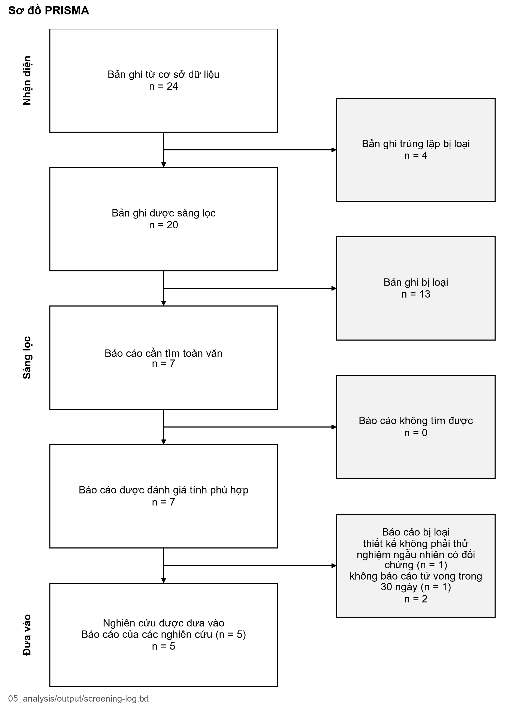
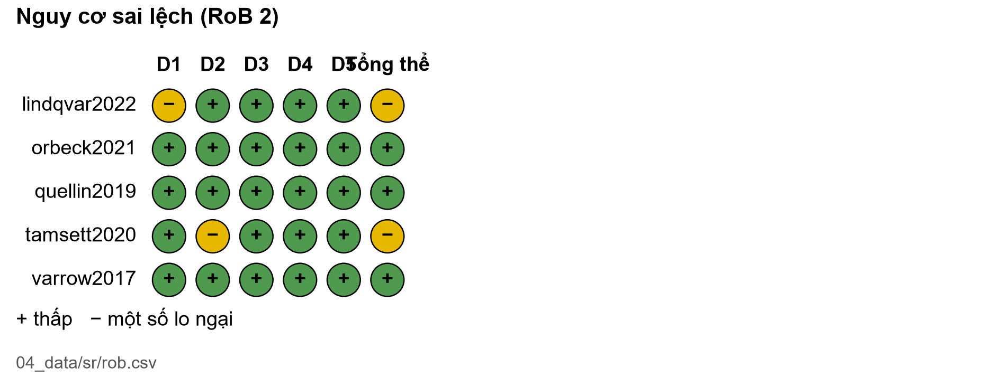
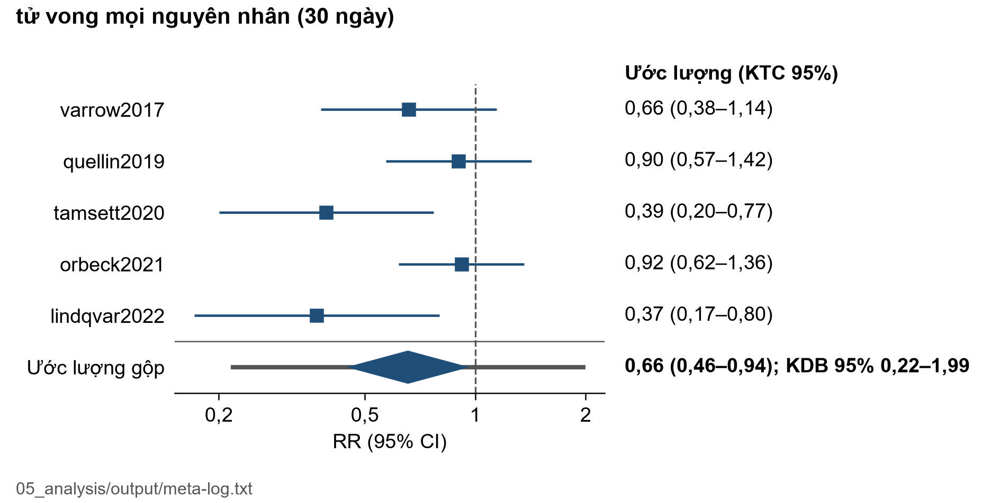

# Kết quả

## Lựa chọn nghiên cứu

Nguồn tìm kiếm duy nhất (Simulated database) cho {{R-A0-021.value}} bản ghi; không có bản ghi nào từ đăng ký
thử nghiệm ({{R-A0-002.value}}). Sau khi loại {{R-A0-003.value}} bản ghi trùng lặp, {{R-A0-004.value}} bản ghi
được sàng lọc tiêu đề/tóm tắt, trong đó {{R-A0-005.value}} bị loại ở bước này. {{R-A0-006.value}} báo cáo được
tìm toàn văn, tất cả đều lấy được ({{R-A0-007.value}} không lấy được); {{R-A0-008.value}} báo cáo được đánh giá
toàn văn, trong đó {{R-A0-009.value}} báo cáo bị loại: bản ghi rec-0006 (<!-- not-a-result: mã bản ghi theo
02_evidence/sr/screening.csv -->, thiết kế không phải thử nghiệm ngẫu nhiên có đối chứng) và bản ghi rec-0007
(<!-- not-a-result: mã bản ghi theo 02_evidence/sr/screening.csv -->, không báo cáo tử vong trong
30 <!-- not-a-result: mốc thời gian theo tiêu chuẩn lựa chọn của đề cương --> ngày) — tương ứng với
{{R-A0-052.value}} và {{R-A0-051.value}} báo cáo theo mỗi lý do loại trừ. Cuối cùng
{{R-A0-010.value}} thử nghiệm ({{R-A0-011.value}} báo cáo) được đưa vào tổng hợp (Hình 1).

## Đặc điểm các nghiên cứu được đưa vào

Bảng 1. Đặc điểm các nghiên cứu được đưa vào

| Mã nghiên cứu | Thiết kế | Dân số | Can thiệp | Chứng | Tổng số người tham gia | RoB 2 (nhận định tổng quát) |
|---|---|---|---|---|---|---|
| varrow2017 [@varrow2017] | RCT | người lớn nhập viện vì viêm phổi cộng đồng | thuốc X | giả dược | {{R-A1-011.n}} | thấp |
| quellin2019 [@quellin2019] | RCT | người lớn nhập viện vì suy tim cấp | thuốc X | giả dược | {{R-A1-012.n}} | thấp |
| tamsett2020 [@tamsett2020] | RCT | người lớn nhập viện vì nhiễm khuẩn huyết | thuốc X | giả dược | {{R-A1-013.n}} | một số lo ngại |
| orbeck2021 [@orbeck2021] | RCT | người từ 65 <!-- not-a-result: tiêu chuẩn tuổi theo trích xuất 04_data/sr/extraction.csv --> tuổi nhập khoa nội | thuốc X | giả dược | {{R-A1-014.n}} | thấp |
| lindqvar2022 [@lindqvar2022] | RCT | người lớn nhập viện vì cúm nặng | thuốc X | giả dược | {{R-A1-015.n}} | một số lo ngại |

Dân số, cỡ mẫu, kết cục và các cột nguy cơ sai lệch đầy đủ theo từng thử nghiệm ở `04_data/sr/extraction.csv`
và `04_data/sr/rob.csv`.

## Nguy cơ sai lệch trong từng nghiên cứu

Theo RoB 2 [@sterne2019], ba trong năm thử nghiệm được đưa vào có nguy cơ sai lệch tổng quát thấp ở mọi miền
(varrow2017 [@varrow2017], quellin2019 [@quellin2019], orbeck2021 [@orbeck2021]). Hai thử nghiệm còn lại có nhận
định "một số lo ngại": tamsett2020 [@tamsett2020] ở miền can thiệp phân công (nhãn mở, không nêu rõ phân tích
theo ý định điều trị cho những người bỏ thuốc) và lindqvar2022 [@lindqvar2022] ở miền ngẫu nhiên hoá (không mô
tả cách che giấu phân bổ, hai nhóm không tương đồng về mức độ nặng ban đầu). Chi tiết theo từng miền ở Hình 2.

## Tổng hợp kết quả — tử vong mọi nguyên nhân (30 ngày)

Năm thử nghiệm ({{R-A1-001.n}} người tham gia) được gộp bằng mô hình hiệu ứng ngẫu nhiên REML. RR gộp là
{{R-A1-001.full}} (p = {{R-A1-001.p}}), thiên về thuốc X. Dị biệt giữa các nghiên cứu ở mức trung bình: τ² =
{{R-A1-002.value}}, I² = {{R-A1-003.value}} (Q = {{R-A1-004.value}}, p = {{R-A1-004.p}}); khoảng dự đoán
95% <!-- not-a-result: mức khoảng dự đoán theo đề cương --> cho một thử nghiệm mới là {{R-A1-005.ci}}, bao
trùm cả giá trị không hiệu quả. Kết quả từng thử nghiệm: varrow2017
{{R-A1-011.full}}, quellin2019 {{R-A1-012.full}}, tamsett2020 {{R-A1-013.full}}, orbeck2021 {{R-A1-014.full}},
lindqvar2022 {{R-A1-015.full}} (Hình 3).

### Phân tích dưới nhóm theo nguy cơ sai lệch tổng quát (A2, đăng ký trước)

Ở nhóm nguy cơ sai lệch thấp (ba thử nghiệm), RR gộp nhóm thấp là {{R-A2-011.full}} (τ² = {{R-A2-012.value}},
I² = {{R-A2-013.value}}); ở nhóm "một số lo ngại" (hai thử nghiệm), RR gộp nhóm lo ngại là {{R-A2-021.full}}
(τ² = {{R-A2-022.value}}, I² = {{R-A2-023.value}}). Khác biệt giữa hai phân nhóm có ý nghĩa thống kê (Q giữa nhóm =
{{R-A2-001.value}}, p = {{R-A2-001.p}}).

### Phân tích độ nhạy — loại dần từng nghiên cứu (A3, đăng ký trước)

Khi loại lần lượt từng thử nghiệm, RR gộp dao động từ {{R-A3-001.full}} (loại varrow2017) đến
{{R-A3-002.full}} (loại quellin2019), {{R-A3-003.full}} (loại tamsett2020), {{R-A3-004.full}} (loại orbeck2021)
và {{R-A3-005.full}} (loại lindqvar2022). Khoảng tin cậy 95% của RR gộp đổi dấu ý nghĩa thống kê (bao trùm 1)
khi loại một trong ba thử nghiệm varrow2017, tamsett2020 hoặc lindqvar2022, cho thấy ước lượng gộp chính không
ổn định trước từng thử nghiệm đơn lẻ.

## Sai lệch công bố

Không đánh giá được bằng kiểm định Egger hay biểu đồ hình phễu vì số nghiên cứu gộp ({{R-A1-001.count}}) nhỏ
hơn ngưỡng quy định trước (k ≥ 10).

## Độ tin cậy của bằng chứng tổng hợp

Độ tin cậy của bằng chứng (GRADE) cho kết cục tử vong mọi nguyên nhân
30 <!-- not-a-result: mốc thời gian theo đề cương --> ngày ở Bảng 2.
