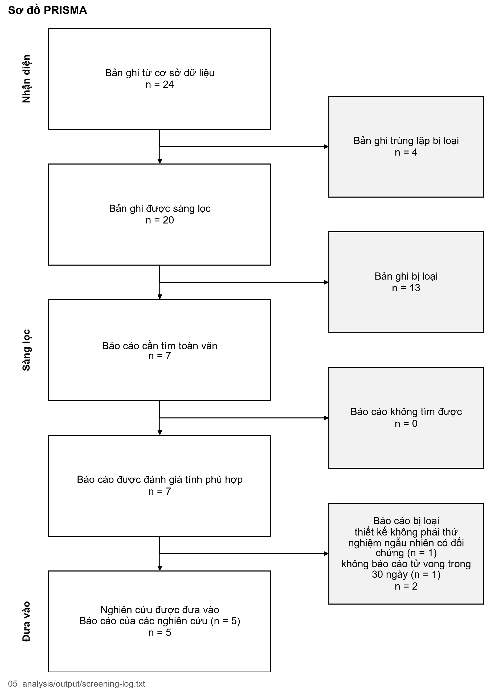
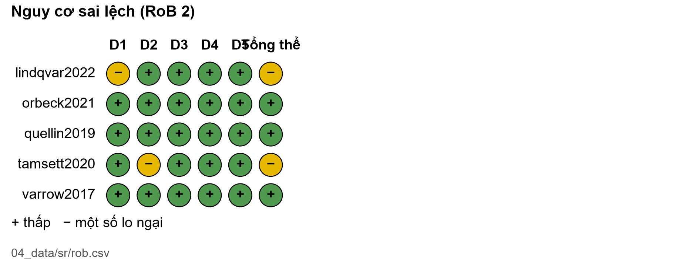
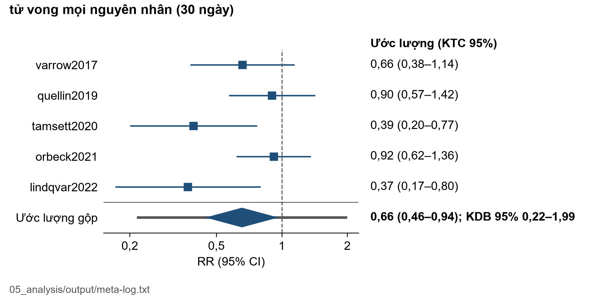

# Thuốc X và tử vong 30 ngày ở người lớn nhập viện vì bệnh nội khoa cấp: tổng quan hệ thống và phân tích gộp các thử nghiệm ngẫu nhiên có đối chứng (hư cấu)

> **LƯU Ý:** Đây là một tổng quan hệ thống và phân tích gộp HƯ CẤU, dùng để minh hoạ quy trình làm việc của phần
> mềm. "Thuốc X" là một can thiệp hư cấu; năm thử nghiệm được đưa vào, hai người đánh giá độc lập (Reviewer A,
> Reviewer B) và nguồn tìm kiếm chính (một tệp xuất mô phỏng) đều là hư cấu. Chi tiết xem phần Tóm tắt và Phương
> pháp. Tài liệu được trích dẫn cho PRISMA 2020, RoB 2, GRADE và các phương pháp thống kê là tài liệu thật.

Tác giả: Example author

Đơn vị công tác: Bệnh viện Mô phỏng (đơn vị hư cấu)

Tác giả liên hệ: không có địa chỉ liên hệ (ví dụ hư cấu dùng để minh hoạ phần mềm)

Người đánh giá độc lập (hư cấu, xem Phương pháp): Reviewer A, Reviewer B.

Đăng ký trước (registration): chưa đăng ký PROSPERO — xem lý do tại mục "Thông tin khác" và bản nháp minh hoạ
`03_protocol/prospero.md`.

\newpage

# Tóm tắt

**Mục tiêu:** Tổng quan hệ thống, phân tích gộp RCT: hiệu quả của thuốc X (hư cấu) so với giả dược với tử vong
mọi nguyên nhân tại 30 <!-- not-a-result: mốc thời gian theo đề cương --> ngày, người lớn nhập viện vì bệnh
nội khoa cấp; minh hoạ quy trình PRISMA 2020.

**Đối tượng và phương pháp:** Bài tập **hư cấu**: thuốc X, năm thử nghiệm, hai người đánh giá (Reviewer A,
Reviewer B) đều không có thật; chỉ tài liệu phương pháp luận trích dẫn là thật. Nguồn tìm kiếm duy nhất: một
tệp xuất mô phỏng ("Simulated database"), chạy một lần. Hai người độc lập sàng lọc, trích xuất, đánh
giá RoB 2, đồng thuận khi bất đồng; gợi ý AI ở bước sàng lọc chỉ là tham khảo. Mô hình hiệu ứng ngẫu nhiên
(REML), báo cáo τ², I², khoảng dự đoán 95% <!-- not-a-result: mức khoảng dự đoán theo đề cương -->; độ tin cậy
chấm theo GRADE.

**Kết quả:** 5 thử nghiệm (1785 người tham gia). RR gộp 0,66 (KTC 95%: 0,46–0,94) (I² =
54,2%; khoảng dự đoán 95% <!-- not-a-result: mức khoảng dự đoán theo đề cương --> 0,22–1,99,
bao trùm mức không hiệu quả). Ước lượng không ổn định ở độ nhạy; khác biệt có ý nghĩa theo phân nhóm nguy cơ
sai lệch (p = 0,006).

**Kết luận:** Thuốc X có thể làm giảm tử vong mọi nguyên nhân
30 <!-- not-a-result: mốc thời gian theo đề cương --> ngày, mức chắc chắn **thấp**. Toàn bộ thuốc,
thử nghiệm, người đánh giá hư cấu; không áp dụng cho thuốc hay bệnh nhân thật. Hạn chế: ít thử nghiệm, nguồn
tìm kiếm duy nhất, không đánh giá được sai lệch công bố. Chưa đăng ký PROSPERO; không có nguồn tài trợ.

\newpage

# Đặt vấn đề

Bài viết này là một tổng quan hệ thống và phân tích gộp **hư cấu**: câu hỏi lâm sàng, "thuốc X", năm thử
nghiệm được đưa vào và hai người đánh giá độc lập (Reviewer A, Reviewer B) đều không tồn tại trong y văn thật.
Mục đích là minh hoạ đầy đủ một quy trình tổng quan hệ thống theo chuẩn PRISMA 2020 [1] — từ xây dựng
câu hỏi PICO, tìm kiếm, sàng lọc hai người độc lập, trích xuất dữ liệu, đánh giá nguy cơ sai lệch bằng RoB 2
[2], phân tích gộp mô hình hiệu ứng ngẫu nhiên đến chấm điểm độ tin cậy bằng GRADE [3] —
bằng một bộ dữ liệu mô phỏng, không nhằm đưa ra bất kỳ khuyến cáo điều trị nào cho người bệnh thật.

Khuôn mẫu giả định cho bài tập này là một thuốc hư cấu ("thuốc X") được giả định dùng cho người lớn nhập viện vì
bệnh nội khoa cấp, so với giả dược, trên kết cục tử vong mọi nguyên nhân trong 30 ngày — một dạng câu hỏi quen
thuộc trong các tổng quan hệ thống về can thiệp điều trị nội trú. Vì không có một thuốc, một thử nghiệm hay một
số liệu dịch tễ thật nào gắn với câu hỏi này, phần đặt vấn đề không trình bày gánh nặng bệnh hay các bằng chứng
lâm sàng có sẵn như một tổng quan hệ thống thông thường; làm vậy sẽ gán một bối cảnh thật cho một can thiệp
không tồn tại.

Điều cần minh hoạ, thay vào đó, là tính nghiêm ngặt về phương pháp: một bản đề cương được khoá trước khi sàng
lọc (gate G2), tiêu chuẩn chọn mẫu và đăng ký phân tích cố định trước khi xem kết quả, hai người đánh giá độc
lập ở mọi bước có thể có bất đồng, và việc báo cáo độ tin cậy của bằng chứng tổng hợp bằng GRADE thay vì chỉ nêu
một con số gộp. `03_protocol/sr-protocol.md` là đề cương đã khoá cho bài tập này, viết trước khi bất kỳ nghiên
cứu nào được đưa vào.

## Mục tiêu nghiên cứu

Ở người lớn (từ 18 tuổi) nhập viện vì bệnh nội khoa cấp, thuốc X (hư cấu) so với giả dược có làm giảm tử vong
mọi nguyên nhân trong 30 ngày không?

# Phương pháp

Bài viết này báo cáo theo PRISMA 2020 [1]. Vì toàn bộ câu hỏi lâm sàng và các nghiên cứu được đưa vào
là hư cấu (xem Tóm tắt, Đặt vấn đề), phần Phương pháp dưới đây mô tả chính xác quy trình đã thực hiện trên bộ dữ
liệu mô phỏng này, không phải một tổng quan hệ thống thật.

## Đăng ký và đề cương

Đề cương (`03_protocol/sr-protocol.md`) được viết và khoá (gate G2) trước khi bất kỳ bản ghi nào được sàng lọc,
gồm tiêu chuẩn chọn mẫu, chiến lược tìm kiếm và một đăng ký phân tích (A0–A3) cố định mô hình thống kê trước khi
xem kết quả. Vì đây là bài tập minh hoạ phần mềm, đề cương không được nộp lên PROSPERO; bản nháp minh hoạ ở
`03_protocol/prospero.md` (không áp dụng ngoài dự án này — xem "Thông tin khác"). Không có sửa đổi nào so với
đề cương đã khoá.

## Tiêu chuẩn lựa chọn

Chỉ nhận thử nghiệm ngẫu nhiên có đối chứng (randomised controlled trial) trên người lớn (từ 18 tuổi) nhập viện
vì bệnh nội khoa cấp, so sánh thuốc X (hư cấu) với giả dược, báo cáo tử vong mọi nguyên nhân trong 30 ngày.
Không giới hạn ngôn ngữ hay năm công bố. Lý do loại trừ ở bước toàn văn được quy định trước trong đề cương:
thiết kế không phải thử nghiệm ngẫu nhiên có đối chứng, không báo cáo tử vong trong 30 ngày, hoặc nhóm chứng
không phải giả dược.

## Nguồn thông tin và chiến lược tìm kiếm

Vì các nghiên cứu được đưa vào là hư cấu, nguồn duy nhất để tìm nghiên cứu đưa vào là một tệp xuất mô phỏng
("Simulated database", nền tảng fictional, mã chuỗi S1 — tác giả tự chạy và xuất, không phải một cơ sở dữ liệu y
văn thật) chạy ngày <!-- not-a-result: 02_evidence/sr/search-log.csv --> 23/11/2026. Chuỗi tìm kiếm đầy đủ ở phụ
lục `02_evidence/sr/strings.md`.

PubMed **không** được dùng để tìm nghiên cứu đưa vào, vì không tồn tại thử nghiệm thật nào về "thuốc X". PubMed
chỉ được dùng, qua `search_lit.py`, để tìm và xác minh (`verify_refs.py`) các tài liệu phương pháp luận thật
được trích dẫn trong bài này: PRISMA 2020 [1], RoB 2 [2], GRADE [3], thống kê I² về
dị biệt [4], khoảng dự đoán [5] và phương pháp REML cho mô hình hiệu ứng ngẫu nhiên
[6]. Không có số liệu hư cấu nào được gán cho các tài liệu thật này.

## Quy trình lựa chọn nghiên cứu

Hai người đánh giá độc lập, hư cấu (Reviewer A, Reviewer B) sàng lọc độc lập từng bản ghi ở hai bước: tiêu
đề/tóm tắt rồi toàn văn. Trước bước sàng lọc tiêu đề/tóm tắt, một trợ lý AI đọc tiêu đề và tóm tắt của từng bản
ghi và ghi lại một **gợi ý** (include/exclude/maybe) kèm lý do vào `02_evidence/sr/ai-suggestions.csv`; gợi ý
này không phải quyết định sàng lọc — quyết định cuối cùng ở cả hai bước do Reviewer A và Reviewer B thực hiện
độc lập trên phiếu riêng của từng người, ghi tại `02_evidence/sr/screening.csv`. Bất đồng được giải quyết bằng
đồng thuận giữa hai người (hàng `consensus`); một hàng đồng thuận chỉ được tính sau khi cả hai người đã quyết
định trên cùng bản ghi. Độ thống nhất giữa hai người đánh giá: κ = 0,89 ở bước tiêu đề/tóm tắt và κ = 0,59 ở
bước toàn văn (<!-- not-a-result: screening.py kappa --stage ta / --stage ft -->).

## Quy trình thu thập dữ liệu và các biến số

Hai người trích xuất độc lập (`04_data/sr/extraction-reviewer-a.csv`, `04_data/sr/extraction-reviewer-b.csv`),
hợp nhất thành một tệp đồng thuận (`04_data/sr/extraction.csv`) sau khi đối chiếu từng bất đồng. Biến số thu
thập cho mỗi thử nghiệm: thiết kế, dân số, cỡ mẫu và số sự kiện tử vong ở mỗi nhóm (thuốc X, giả dược) cho kết
cục tử vong mọi nguyên nhân tại 30 ngày, và nhận định nguy cơ sai lệch tổng quát. Vì các thử nghiệm là hư cấu,
không có tác giả nghiên cứu thật nào để liên hệ khi thiếu dữ liệu; một bất đồng về số sự kiện tử vong ở nhóm giả
dược của thử nghiệm tamsett2020 [7] được ghi lại và giải quyết bằng đồng thuận (xem cột
`consensus_note` trong tệp trích xuất), không suy diễn số liệu còn thiếu.

## Kết cục

Kết cục duy nhất trong đăng ký phân tích: tử vong mọi nguyên nhân tại thời điểm 30 ngày.

## Nguy cơ sai lệch trong từng nghiên cứu

Nguy cơ sai lệch của mỗi thử nghiệm được đánh giá bằng công cụ RoB 2 (Cochrane risk-of-bias tool for randomized
trials) [2] trên 5 miền (ngẫu nhiên hoá, sai lệch do can thiệp phân công, dữ liệu kết cục thiếu, đo
lường kết cục, lựa chọn kết quả báo cáo), với nhận định tổng quát theo đúng thuật toán của công cụ (mức xấu nhất
trong các miền, không phải điểm cộng dồn). Cả Reviewer A và Reviewer B đánh giá độc lập; bất đồng giải quyết
bằng đồng thuận. Chi tiết theo từng miền và từng thử nghiệm ở `04_data/sr/rob.csv` và Hình 2.

## Thước đo hiệu quả

Risk ratio (RR) cho kết cục tử vong mọi nguyên nhân 30 ngày.

## Phương pháp tổng hợp

Một thử nghiệm đủ điều kiện gộp vào phân tích chính khi đáp ứng tiêu chuẩn lựa chọn (Tiêu chuẩn lựa chọn) và
báo cáo được số sự kiện tử vong trên số người theo dõi ở từng nhóm (bảng 2×2) cho kết cục tử vong mọi nguyên
nhân tại 30 ngày; cả năm thử nghiệm được đưa vào đều đáp ứng điều kiện này, không có số liệu nào cần suy diễn
hay quy đổi đơn vị trước khi gộp. Bất đồng duy nhất về số liệu trích xuất (tamsett2020 [7], số sự
kiện tử vong ở nhóm giả dược) được giải quyết bằng đồng thuận giữa hai người đánh giá trước khi đưa vào phân
tích gộp (xem Quy trình thu thập dữ liệu).

Các thử nghiệm đủ điều kiện được gộp bằng mô hình hiệu ứng ngẫu nhiên, ước lượng phương sai giữa nghiên cứu bằng
phương pháp REML (restricted maximum likelihood) — một trong các phương pháp ước lượng phương sai giữa nghiên
cứu được so sánh bởi Veroniki và cộng sự [6] — không hiệu chỉnh Hartung-Knapp-Sidik-Jonkman.
Mô hình này được chọn trước khi xem bất kỳ kết quả nào, ghi trong đăng ký phân tích của đề cương (A1); một thay
đổi mô hình sau khi khoá đề cương sẽ được ghi là một dòng `DEVIATION` trong `decisions.md` — không có sửa đổi
nào ở bài viết này. Dị biệt giữa các nghiên cứu được báo cáo bằng τ², thống kê I² [4] và khoảng dự
đoán (prediction interval) 95% [5] — khoảng dự đoán chỉ được tính khi số nghiên cứu gộp k ≥ 3, theo
quy định trước của đề cương (`03_protocol/sr-protocol.md` mục 3.8). Hai phân tích bổ sung được đăng ký
trước: phân tích dưới nhóm theo nhận định nguy cơ sai lệch tổng quát (A2) và phân tích loại dần từng nghiên cứu
(leave-one-out, A3) để kiểm tra độ nhạy của ước lượng gộp chính. Kết quả tổng hợp được trình bày bằng một bảng
đặc điểm nghiên cứu, một forest plot và một bảng tóm tắt kết quả GRADE (Kết quả).

Tính toán được thực hiện bằng công cụ `meta.py` và `grade.py` của phần mềm dự án này (Python, thư viện chuẩn),
không dùng gói R/metafor.

## Đánh giá sai lệch công bố

Kiểm định Egger và biểu đồ hình phễu chỉ được quy định thực hiện khi số nghiên cứu gộp k ≥ 10; vì phân tích gộp
chính chỉ gộp năm thử nghiệm, sai lệch công bố không được đánh giá bằng kiểm định thống kê — đây là một hạn chế
được nêu lại ở phần Bàn luận.

## Đánh giá độ tin cậy của bằng chứng tổng hợp

Độ tin cậy của bằng chứng cho kết cục tử vong mọi nguyên nhân 30 ngày được chấm theo GRADE (Grading of
Recommendations Assessment, Development and Evaluation) [3], xuất phát từ mức cao cho bằng chứng từ
thử nghiệm ngẫu nhiên và hạ bậc theo nguy cơ sai lệch, tính không thống nhất, tính gián tiếp, tính không chính
xác và sai lệch công bố, với lý do hạ bậc ghi tại `05_analysis/meta/grade.json`. Bảng tóm tắt kết quả (summary
of findings) ở Bảng 2.

# Kết quả

## Lựa chọn nghiên cứu

Nguồn tìm kiếm duy nhất (Simulated database) cho 24 bản ghi; không có bản ghi nào từ đăng ký
thử nghiệm (0). Sau khi loại 4 bản ghi trùng lặp, 20 bản ghi
được sàng lọc tiêu đề/tóm tắt, trong đó 13 bị loại ở bước này. 7 báo cáo được
tìm toàn văn, tất cả đều lấy được (0 không lấy được); 7 báo cáo được đánh giá
toàn văn, trong đó 2 báo cáo bị loại: bản ghi rec-0006 (<!-- not-a-result: mã bản ghi theo
02_evidence/sr/screening.csv -->, thiết kế không phải thử nghiệm ngẫu nhiên có đối chứng) và bản ghi rec-0007
(<!-- not-a-result: mã bản ghi theo 02_evidence/sr/screening.csv -->, không báo cáo tử vong trong
30 <!-- not-a-result: mốc thời gian theo tiêu chuẩn lựa chọn của đề cương --> ngày) — tương ứng với
1 và 1 báo cáo theo mỗi lý do loại trừ. Cuối cùng
5 thử nghiệm (5 báo cáo) được đưa vào tổng hợp (Hình 1).

## Đặc điểm các nghiên cứu được đưa vào

Bảng 1. Đặc điểm các nghiên cứu được đưa vào

| Mã nghiên cứu | Thiết kế | Dân số | Can thiệp | Chứng | Tổng số người tham gia | RoB 2 (nhận định tổng quát) |
|---|---|---|---|---|---|---|
| varrow2017 [8] | RCT | người lớn nhập viện vì viêm phổi cộng đồng | thuốc X | giả dược | 298 | thấp |
| quellin2019 [9] | RCT | người lớn nhập viện vì suy tim cấp | thuốc X | giả dược | 438 | thấp |
| tamsett2020 [7] | RCT | người lớn nhập viện vì nhiễm khuẩn huyết | thuốc X | giả dược | 192 | một số lo ngại |
| orbeck2021 [10] | RCT | người từ 65 <!-- not-a-result: tiêu chuẩn tuổi theo trích xuất 04_data/sr/extraction.csv --> tuổi nhập khoa nội | thuốc X | giả dược | 615 | thấp |
| lindqvar2022 [11] | RCT | người lớn nhập viện vì cúm nặng | thuốc X | giả dược | 242 | một số lo ngại |

Dân số, cỡ mẫu, kết cục và các cột nguy cơ sai lệch đầy đủ theo từng thử nghiệm ở `04_data/sr/extraction.csv`
và `04_data/sr/rob.csv`.

## Nguy cơ sai lệch trong từng nghiên cứu

Theo RoB 2 [2], ba trong năm thử nghiệm được đưa vào có nguy cơ sai lệch tổng quát thấp ở mọi miền
(varrow2017 [8], quellin2019 [9], orbeck2021 [10]). Hai thử nghiệm còn lại có nhận
định "một số lo ngại": tamsett2020 [7] ở miền can thiệp phân công (nhãn mở, không nêu rõ phân tích
theo ý định điều trị cho những người bỏ thuốc) và lindqvar2022 [11] ở miền ngẫu nhiên hoá (không mô
tả cách che giấu phân bổ, hai nhóm không tương đồng về mức độ nặng ban đầu). Chi tiết theo từng miền ở Hình 2.

## Tổng hợp kết quả — tử vong mọi nguyên nhân (30 ngày)

Năm thử nghiệm (1785 người tham gia) được gộp bằng mô hình hiệu ứng ngẫu nhiên REML. RR gộp là
0,66 (KTC 95%: 0,46–0,94) (p = 0,021), thiên về thuốc X. Dị biệt giữa các nghiên cứu ở mức trung bình: τ² =
0,089, I² = 54,2% (Q = 8,47, p = 0,076); khoảng dự đoán
95% <!-- not-a-result: mức khoảng dự đoán theo đề cương --> cho một thử nghiệm mới là 0,22–1,99, bao
trùm cả giá trị không hiệu quả. Kết quả từng thử nghiệm: varrow2017
0,66 (KTC 95%: 0,38–1,14), quellin2019 0,90 (KTC 95%: 0,57–1,42), tamsett2020 0,39 (KTC 95%: 0,20–0,77), orbeck2021 0,92 (KTC 95%: 0,62–1,36),
lindqvar2022 0,37 (KTC 95%: 0,17–0,80) (Hình 3).

### Phân tích dưới nhóm theo nguy cơ sai lệch tổng quát (A2, đăng ký trước)

Ở nhóm nguy cơ sai lệch thấp (ba thử nghiệm), RR gộp nhóm thấp là 0,85 (KTC 95%: 0,65–1,10) (τ² = 0,000,
I² = 0,0%); ở nhóm "một số lo ngại" (hai thử nghiệm), RR gộp nhóm lo ngại là 0,38 (KTC 95%: 0,23–0,63)
(τ² = 0,000, I² = 0,0%). Khác biệt giữa hai phân nhóm có ý nghĩa thống kê (Q giữa nhóm =
7,42, p = 0,006).

### Phân tích độ nhạy — loại dần từng nghiên cứu (A3, đăng ký trước)

Khi loại lần lượt từng thử nghiệm, RR gộp dao động từ 0,64 (KTC 95%: 0,39–1,03) (loại varrow2017) đến
0,59 (KTC 95%: 0,38–0,91) (loại quellin2019), 0,75 (KTC 95%: 0,55–1,02) (loại tamsett2020), 0,58 (KTC 95%: 0,38–0,89) (loại orbeck2021)
và 0,73 (KTC 95%: 0,53–1,02) (loại lindqvar2022). Khoảng tin cậy 95% của RR gộp đổi dấu ý nghĩa thống kê (bao trùm 1)
khi loại một trong ba thử nghiệm varrow2017, tamsett2020 hoặc lindqvar2022, cho thấy ước lượng gộp chính không
ổn định trước từng thử nghiệm đơn lẻ.

## Sai lệch công bố

Không đánh giá được bằng kiểm định Egger hay biểu đồ hình phễu vì số nghiên cứu gộp (5) nhỏ
hơn ngưỡng quy định trước (k ≥ 10).

## Độ tin cậy của bằng chứng tổng hợp

Độ tin cậy của bằng chứng (GRADE) cho kết cục tử vong mọi nguyên nhân
30 <!-- not-a-result: mốc thời gian theo đề cương --> ngày ở Bảng 2.

Bảng 2. Tóm tắt kết quả (summary of findings)
| Kết cục | Số nghiên cứu (người tham gia) | Hiệu quả tương đối (KTC 95%) | Nguy cơ ở nhóm so sánh (trên 1000 <!-- not-a-result: mẫu số GRADE -->) | Nguy cơ ở nhóm can thiệp (KTC 95%) | Chênh lệch (KTC 95%) | Mức chắc chắn |
|---|---|---|---|---|---|---|
| tử vong mọi nguyên nhân (30 <!-- not-a-result: mốc thời gian trong tên kết cục --> ngày) | 5 (1785) | 0,66 (KTC 95%: 0,46–0,94) | 180 | 118 (KTC 95%: 82–169) | -62 (KTC 95%: -98 đến -11) | ⊕⊕◯◯ Thấp |

- Mức chắc chắn (GRADE): cao, trung bình, thấp, rất thấp. Nguy cơ giả định ở nhóm so sánh: trung vị nguy cơ tử vong 30 <!-- not-a-result: mốc thời gian trong tên kết cục --> ngày ở nhóm giả dược của năm thử nghiệm được đưa vào (số liệu hư cấu). Lý do: risk of bias: hạ một bậc (Hai trong năm thử nghiệm có 'some concerns' theo RoB 2 (tamsett2020 miền D2, lindqvar2022 miền D1) và hiệu ứng gộp phụ thuộc nhiều vào hai thử nghiệm này.); imprecision: hạ một bậc (Ít sự kiện, giới hạn trên của khoảng tin cậy gần mức không hiệu quả và khoảng dự đoán bao trùm mức không hiệu quả.).

# Bàn luận

## Kết quả chính

Trên bộ dữ liệu mô phỏng này, gộp năm thử nghiệm ngẫu nhiên có đối chứng, thuốc X (hư cấu) có thể làm giảm tử
vong mọi nguyên nhân tại 30 <!-- not-a-result: mốc thời gian theo đề cương --> ngày so với giả dược ở người
lớn nhập viện vì bệnh nội khoa cấp: RR gộp 0,66 (KTC 95%: 0,46–0,94). Mức chắc chắn của bằng chứng này là thấp (Bảng 2),
vì vậy phát biểu trên cần đọc với từ "có thể" — không phải một kết luận chắc chắn. Khoảng dự đoán
95% <!-- not-a-result: mức khoảng dự đoán theo đề cương --> cho một thử nghiệm mới (0,22–1,99) bao trùm
cả mức không hiệu quả, và kết quả không ổn định trước việc loại từng thử nghiệm đơn lẻ, nên hiệu quả gộp nêu
trên không nên được xem là một ước lượng chắc chắn ngay cả trong phạm vi bộ dữ liệu hư cấu này.

## So sánh với các nghiên cứu khác

Vì "thuốc X" và cả năm thử nghiệm được đưa vào đều là hư cấu, không có một thử nghiệm hay tổng quan hệ thống
thật nào trong y văn để so sánh kết quả này. Sự không thống nhất quan sát được giữa các thử nghiệm phần lớn gắn
với nhận định nguy cơ sai lệch: phân tích dưới nhóm theo `rob_overall` cho khác biệt có ý nghĩa thống kê giữa
nhóm nguy cơ sai lệch thấp và nhóm "một số lo ngại" (Kết quả). Vì hai thử nghiệm "một số lo ngại" cũng là hai
dân số bệnh nhân khác với ba thử nghiệm "thấp" (Bảng 1, Hạn chế), không thể kết luận phần nào của sự không
thống nhất này là do sai lệch trong hai thử nghiệm nhãn mở/không che giấu phân bổ, phần nào là do khác biệt dân
số — hai khả năng này nhiễu lẫn nhau trong bộ dữ liệu mô phỏng này.

## Cơ chế tác dụng

Không bàn về cơ chế dược lý của thuốc X: đây là một can thiệp hư cấu, không có cơ chế tác dụng thật nào để trích
dẫn; suy đoán về cơ chế ở đây sẽ là bịa đặt, không phải tổng hợp bằng chứng.

## Điểm mạnh

Đề cương được viết và khoá trước khi sàng lọc, với tiêu chuẩn chọn mẫu và một đăng ký phân tích (mô hình, thước
đo hiệu quả, phân tích dưới nhóm, phân tích độ nhạy) cố định trước khi xem kết quả. Sàng lọc, trích xuất và đánh
giá nguy cơ sai lệch đều do hai người độc lập thực hiện ở mọi bước, với bất đồng giải quyết bằng đồng thuận;
gợi ý từ một trợ lý AI ở bước sàng lọc tiêu đề/tóm tắt chỉ là gợi ý tham khảo, không phải quyết định. Dị biệt
được báo cáo đầy đủ bằng τ², I² và khoảng dự đoán, thay vì chỉ nêu một RR gộp và khoảng tin cậy. Độ tin cậy của
bằng chứng được chấm bằng GRADE với lý do hạ bậc ghi lại minh bạch, không chỉ nêu một con số.

## Hạn chế

Hạn chế lớn nhất, và cần nêu trước mọi hạn chế khác: toàn bộ bằng chứng trong bài viết này — thuốc, các thử
nghiệm, người đánh giá — là hư cấu, mô phỏng để minh hoạ một quy trình phần mềm. Kết quả không có giá trị ngoại
suy cho bất kỳ thuốc hay bệnh nhân thật nào và không nên được trích dẫn như một bằng chứng lâm sàng.

Trong phạm vi bộ dữ liệu mô phỏng này, các hạn chế về phương pháp còn gồm: số thử nghiệm gộp nhỏ
(5 thử nghiệm) khiến ước lượng gộp kém chính xác và không đủ cơ sở để đánh giá sai lệch công bố
bằng kiểm định Egger hay biểu đồ hình phễu (ngưỡng quy định trước là k ≥ 10) — nếu có, sai lệch công bố thường
theo chiều làm thử nghiệm có kết quả dương tính (ủng hộ thuốc X) dễ được công bố hơn, nên hiệu quả gộp nêu trên
nhiều khả năng bị thổi phồng theo chiều có lợi hơn là bị đánh giá thấp; phân tích dưới nhóm theo nguy cơ
sai lệch chỉ dựa trên hai và ba thử nghiệm mỗi nhóm nên bản thân phân tích này cũng kém chính xác; nhận định
nguy cơ sai lệch tổng quát ở đây cũng trùng khớp với dân số của từng thử nghiệm (hai thử nghiệm "một số lo
ngại" là hai dân số khác với ba thử nghiệm "thấp"), nên nguy cơ sai lệch và dân số bị nhiễu lẫn nhau — không thể
tách riêng phần nào của khác biệt giữa hai phân nhóm là do sai lệch, phần nào là do khác biệt dân số; sai lệch
thông tin (information bias) trong đo lường kết cục nhiều khả năng thấp vì tử vong mọi nguyên nhân là một kết
cục khách quan, ít phụ thuộc vào việc người đánh giá kết cục có bị mù hay không — cả năm thử nghiệm đều được
đánh giá RoB 2 miền D4 (đo lường kết cục) ở mức thấp (`04_data/sr/rob.csv`); dữ liệu kết cục thiếu cũng nhiều
khả năng không phải vấn đề lớn, vì cả năm thử nghiệm đều được đánh giá RoB 2 miền D3 (dữ liệu kết cục thiếu) ở
mức thấp, với trên 98% <!-- not-a-result: hỗ trợ miền D3, 04_data/sr/rob.csv --> người tham gia được theo dõi
đủ 30 <!-- not-a-result: mốc thời gian theo đề cương --> ngày (`04_data/sr/rob.csv`); phân tích độ
nhạy cho thấy ước lượng gộp chính không ổn định trước việc loại từng thử nghiệm đơn lẻ; và vì các thử nghiệm là
hư cấu, một bất đồng về số liệu trích xuất (tamsett2020 [7]) chỉ có thể giải quyết bằng đồng thuận
giữa hai người đánh giá, không thể liên hệ tác giả gốc để xác minh — một hạn chế thường gặp khi trích xuất dữ
liệu từ báo cáo công bố. Cuối cùng, năm thử nghiệm được mô phỏng trên năm dân số bệnh nội khoa cấp khác nhau
(viêm phổi cộng đồng, suy tim cấp, nhiễm khuẩn huyết, người cao tuổi nhập khoa nội, cúm nặng — Bảng 1); ngay cả
trong phạm vi bài tập hư cấu này, RR gộp không nên suy diễn cho một dân số bệnh nội khoa cấp cụ thể nào ngoài
năm dân số đã mô phỏng.

Ngoài các hạn chế của bằng chứng, quy trình tìm kiếm của chính bài tập này cũng có hạn chế: chỉ một nguồn mô
phỏng (Simulated database) được tìm, chạy một lần, không có tìm kiếm y văn xám (grey literature) hay tra cứu
đăng ký thử nghiệm bổ sung — phù hợp vì bản thân các thử nghiệm là hư cấu và chỉ tồn tại trong tệp xuất mô
phỏng đó, nhưng nếu đây là một tổng quan hệ thống thật thì một nguồn tìm kiếm duy nhất, chạy một lần, sẽ là một
hạn chế thật của quy trình tìm kiếm.

## Ý nghĩa đối với thực hành và nghiên cứu

Không có ý nghĩa đối với thực hành lâm sàng: đây là một bài tập minh hoạ phần mềm trên dữ liệu hư cấu, không
phải một tổng quan hệ thống về một thuốc thật. Đối với nghiên cứu phương pháp, bài viết này minh hoạ rằng một
quy trình đầy đủ theo PRISMA 2020 [1] — đề cương khoá trước, hai người đánh giá độc lập, RoB 2
[2], đăng ký phân tích trước khi xem kết quả và GRADE [3] — có thể thực hiện được với một
công cụ phần mềm có kiểm soát số liệu bằng ledger và cổng khoá (gate), kể cả khi bằng chứng cuối cùng chỉ chắc
chắn ở mức thấp.

# Kết luận

Trên bộ dữ liệu mô phỏng được xây dựng để minh hoạ quy trình tổng quan hệ thống của phần mềm — không phải một
bằng chứng lâm sàng thật — thuốc X (hư cấu) có thể làm giảm tử vong mọi nguyên nhân tại
30 <!-- not-a-result: mốc thời gian theo đề cương --> ngày so với giả dược ở người lớn nhập viện vì bệnh nội
khoa cấp, với mức chắc chắn thấp: RR gộp 0,66 (KTC 95%: 0,46–0,94), khoảng dự đoán
95% <!-- not-a-result: mức khoảng dự đoán theo đề cương --> 0,22–1,99 bao trùm mức không hiệu quả, và
ước lượng gộp không ổn định trước phân tích độ nhạy loại dần từng thử nghiệm. Vì toàn bộ thuốc, thử nghiệm và
người đánh giá trong bài viết này đều là hư cấu, kết luận trên chỉ có giá trị trong phạm vi bài tập minh hoạ
phần mềm này và không áp dụng cho bất kỳ thuốc hay bệnh nhân thật nào.

<!-- results: R-A1-001, R-A1-005, R-A3-001, R-A3-002, R-A3-003, R-A3-004, R-A3-005 -->

# Thông tin khác

## Đăng ký và đề cương

Tổng quan hệ thống này **chưa đăng ký** PROSPERO. Đây là một bài tập minh hoạ phần mềm, không phải một tổng
quan hệ thống thật, nên không nộp lên một đăng ký thử nghiệm thật; một bản nháp minh hoạ cùng cấu trúc PROSPERO
được viết tại `03_protocol/prospero.md` chỉ để minh hoạ phần mềm, không phải một hồ sơ đăng ký. Đề cương đầy đủ
ở `03_protocol/sr-protocol.md`, được khoá trước khi sàng lọc; không có sửa đổi nào so với đề cương đã khoá.

## Vai trò của trợ lý AI

Một trợ lý AI tạo gợi ý (include/exclude/maybe, kèm lý do) cho bước sàng lọc tiêu đề/tóm tắt, lưu tại
`02_evidence/sr/ai-suggestions.csv`. Gợi ý này không phải quyết định sàng lọc; quyết định ở mọi bước sàng lọc,
trích xuất và đánh giá nguy cơ sai lệch đều do hai người đánh giá độc lập (hư cấu) thực hiện, bất đồng giải
quyết bằng đồng thuận (xem Phương pháp).

## Tài trợ

Không có nguồn tài trợ. Đây là dự án minh hoạ phần mềm, không có nhà tài trợ và không có vai trò của nhà tài
trợ cần khai báo.

## Xung đột lợi ích

Tác giả không có xung đột lợi ích. Đây là tổng quan hư cấu để minh hoạ phần mềm, không nhận tài trợ.

## Đóng góp của tác giả

Example author (tác giả): xây dựng câu hỏi nghiên cứu và đề cương, viết bản thảo. Reviewer A và Reviewer B
(hư cấu, xem Phương pháp): sàng lọc tiêu đề/tóm tắt và toàn văn, trích xuất dữ liệu, đánh giá nguy cơ sai lệch
RoB 2 — mỗi bước độc lập, bất đồng giải quyết bằng đồng thuận.

## Phê duyệt đạo đức

Không áp dụng. Đây là dự án minh hoạ phần mềm trên dữ liệu hư cấu/mô phỏng, không có người tham gia nghiên cứu
thật và không thu thập dữ liệu người bệnh thật, nên không cần phê duyệt của hội đồng đạo đức.

## Khả năng tiếp cận dữ liệu, mã nguồn và các vật liệu khác

Toàn bộ dữ liệu mô phỏng, mã nguồn ledger và các tệp trung gian của bài viết này nằm trong thư mục dự án:
chiến lược tìm kiếm (`02_evidence/sr/strings.md`), nhật ký tìm kiếm (`02_evidence/sr/search-log.csv`), sàng lọc
(`02_evidence/sr/screening.csv`, `02_evidence/sr/ai-suggestions.csv`), trích xuất (`04_data/sr/extraction.csv`
và hai tệp của từng người đánh giá), nguy cơ sai lệch (`04_data/sr/rob.csv`), kết quả phân tích gộp và GRADE
(`05_analysis/meta/`, `05_analysis/output/`), và ledger kết quả dùng để tạo mọi số liệu trong bài viết này
(`ledgers/results-ledger.json`).

\newpage

# TÀI LIỆU THAM KHẢO

1. Page MJ, McKenzie JE, Bossuyt PM, Boutron I, Hoffmann TC, Mulrow CD, et al. The PRISMA 2020 statement: an updated guideline for reporting systematic reviews. BMJ. 2021;372:n71. doi:10.1136/bmj.n71. PMID: 33782057.
2. Sterne JAC, Savović J, Page MJ, Elbers RG, Blencowe NS, Boutron I, et al. RoB 2: a revised tool for assessing risk of bias in randomised trials. BMJ. 2019;366:l4898. doi:10.1136/bmj.l4898. PMID: 31462531.
3. Guyatt GH, Oxman AD, Vist GE, Kunz R, Falck-Ytter Y, Alonso-Coello P, et al. GRADE: an emerging consensus on rating quality of evidence and strength of recommendations. BMJ. 2008;336(7650):924-6. doi:10.1136/bmj.39489.470347.AD. PMID: 18436948.
4. Higgins JP, Thompson SG, Deeks JJ, Altman DG. Measuring inconsistency in meta-analyses. BMJ. 2003;327(7414):557-60. doi:10.1136/bmj.327.7414.557. PMID: 12958120.
5. IntHout J, Ioannidis JP, Rovers MM, Goeman JJ. Plea for routinely presenting prediction intervals in meta-analysis. BMJ Open. 2016;6(7):e010247. doi:10.1136/bmjopen-2015-010247. PMID: 27406637.
6. Veroniki AA, Jackson D, Viechtbauer W, Bender R, Bowden J, Knapp G, et al. Methods to estimate the between-study variance and its uncertainty in meta-analysis. Res Synth Methods. 2016;7(1):55-79. doi:10.1002/jrsm.1164. PMID: 26332144.
7. Tamsett I, Moreau G. Fictional trial of drug X versus placebo in hospitalised adults with sepsis. Journal of Fictional Clinical Trials. 2020.
8. Varrow A, Pike R. Fictional trial: drug X versus placebo and 30-day mortality in adults hospitalised with community-acquired pneumonia. Journal of Fictional Clinical Trials. 2017.
9. Quellin M, Hask T. Fictional trial of drug X in adults admitted with acute heart failure: a randomised placebo-controlled study. Journal of Fictional Clinical Trials. 2019.
10. Orbeck S, Lune P. Fictional trial: early drug X in older adults admitted to general medical wards. Journal of Fictional Clinical Trials. 2021.
11. Lindqvar E, Brook H. Fictional trial of drug X for adults hospitalised with severe influenza. Journal of Fictional Clinical Trials. 2022.
